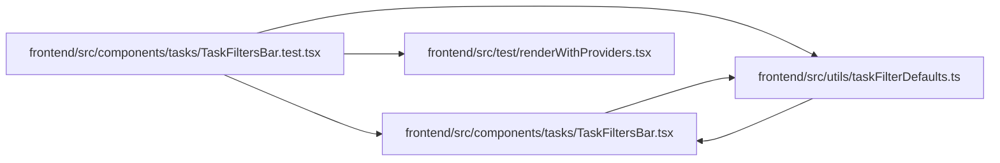

# TaskFiltersBar.test Module

**Path:** `frontend/src/components/tasks/TaskFiltersBar.test.tsx`

## Description

_Auto-generated from `frontend/src/components/tasks/TaskFiltersBar.test.tsx`._

## Imports

| Source | Symbols | Type-only | Runtime emission |
|--------|---------|-----------|------------------|
| `../../test/renderWithProviders` | `renderWithProviders` | — | compiler-dependent |
| `../../utils/taskFilterDefaults` | `defaultFilters` | — | compiler-dependent |
| `./TaskFiltersBar` | `TaskFiltersBar` | — | compiler-dependent |
| `@testing-library/react` | `screen` | — | compiler-dependent |
| `vitest` | `describe`, `expect`, `it`, `vi` | — | compiler-dependent |

## Module Signals

| Signal | Values |
|--------|--------|
| Module calls | `mock`, `mock`, `mock`, `describe` |

## Local dependency map

<!-- Auto-generated local dependency summary. Do not edit by hand. -->

### Internal neighbors

| Direction | Module |
|---|---|
| Outbound | [TaskFiltersBar](../modules/TaskFiltersBar.md) |
| Outbound | [renderWithProviders](../modules/renderWithProviders.md) |
| Outbound | [taskFilterDefaults](../modules/taskFilterDefaults.md) |

### External packages

| Language | Used packages | Undeclared packages |
|---|---:|---:|
| typescript | 2 | 0 |
