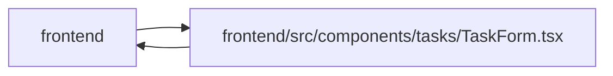

# TaskForm Module

**Path:** `frontend/src/components/tasks/TaskForm.tsx`

## Description

Places title, durable owner, capacity assignment, estimates and commitment state before the canonical brief. AI assistance is an intentional disclosure. The shared editor guards task, work and discussion drafts, preserves conflicts, and separates delivery prerequisites and discussion from current execution evidence. Status changes stay locked while any draft is unsaved, and the form says so.

Task writes persist an uncertain-outcome checkpoint before the request. Restored or unverified outcomes require an authoritative current read and explicit comparison before submitting again; bounded missing matches do not prove failure. Inputs and original observations remain intact, and completion of a removed editor cannot clear or navigate its replacement.

New scheduled task drafts capture one coherent initial iteration revision and persist it alongside user input. Live reference-query revisions never replace this base at save; recovered unversioned drafts require explicit comparison before adoption.

An unresolved write freezes its submitted draft and every write target. Its persisted operation kind selects the correct bounded task or triage comparison; older unknown targets compare both explicitly before resuming.

## Imports

| Source | Symbols | Type-only | Runtime emission |
|--------|---------|-----------|------------------|
| `../../features/identity/identityContext` | `useIdentity` | — | compiler-dependent |
| `../../features/usePlanningObservation` | `usePlanningObservation` | — | compiler-dependent |
| `../../i18n/seedDisplay` | `templateDisplay` | — | compiler-dependent |
| `../../services/iterationService` | `iterationService` | — | compiler-dependent |
| `../../services/projectService` | `projectService` | — | compiler-dependent |
| `../../services/taskService` | `taskService` | — | compiler-dependent |
| `../../services/teamService` | `teamService` | — | compiler-dependent |
| `../../services/templateService` | `templateService` | — | compiler-dependent |
| `../../services/triageService` | `triageService` | — | compiler-dependent |
| `../../types/iteration` | `Iteration` | Declaration | erased |
| `../../types/task` | `GroundedAISuggestionResponse`, `TaskAISuggestRequest`, `TaskCreate`, `Task`, `TaskUpdate` | Declaration | erased |
| `../../types/template` | `WorkTemplate` | Declaration | erased |
| `../../types/triage` | `TriageItemCreate` | Declaration | erased |
| `../../utils/apiError` | `getApiErrorMessage` | — | compiler-dependent |
| `../../utils/formatDate` | `formatDate` | — | compiler-dependent |
| `../../utils/templateDefaults` | `getPayloadBoolean`, `getPayloadString`, `mergeLabels` | — | compiler-dependent |
| `../common/Button` | `Button` | — | compiler-dependent |
| `../common/CollapsibleSection` | `CollapsibleSection` | — | compiler-dependent |
| `../common/ConfirmDialog` | `ConfirmDialog` | — | compiler-dependent |
| `../common/Input` | `Input` | — | compiler-dependent |
| `../feedback/QueryState` | `QueryErrorState` | — | compiler-dependent |
| `../labels/LabelSelector` | `LabelSelector` | — | compiler-dependent |
| `../team/AssigneeRecommendationsPanel` | `AssigneeRecommendationsPanel` | — | compiler-dependent |
| `./DeliveryDependencies` | `DeliveryDependencies` | — | compiler-dependent |
| `./PersonCapacity` | `PersonCapacity` | — | compiler-dependent |
| `./StatusChangeControl` | `StatusChangeControl` | — | compiler-dependent |
| `./TaskAgentReadinessBadge` | `TaskAgentReadinessBadge` | — | compiler-dependent |
| `./TaskBriefEditor` | `TaskBriefEditor` | — | compiler-dependent |
| `./TaskDependencySelector` | `TaskDependencySelector` | — | compiler-dependent |
| `./TaskDiscussion` | `TaskDiscussion` | — | compiler-dependent |
| `./TaskTimelinePanel` | `TaskTimelinePanel` | — | compiler-dependent |
| `./TaskWorkPanel` | `TaskWorkPanel` | — | compiler-dependent |
| `./TimeEntriesPanel` | `TimeEntriesPanel` | — | compiler-dependent |
| `./taskDraftStorage` | `readTaskDraft`, `writeTaskDraft`, `removeTaskDraft`, `readPendingTaskWrite` | — | compiler-dependent |
| `./taskEditorContract` | `TaskConflictMetadata`, `TaskEditorValues` | Specifier | compiler-dependent |
| `./taskEditorContract` | `emptyTaskBrief`, `newCriterion`, `buildTaskEditorDefaults`, `mapTaskEditorServerError`, `toTaskCreate`, `toTaskUpdate`, `validateTaskEditor` | — | compiler-dependent |
| `./useDraftDismissal` | `useActiveMount` | — | compiler-dependent |
| `@tanstack/react-query` | `useMutation`, `useQueryClient`, `useQuery` | — | compiler-dependent |
| `lucide-react` | `Inbox`, `Save`, `Sparkles` | — | compiler-dependent |
| `react` | `useCallback`, `useEffect`, `useId`, `useMemo`, `useState` | — | compiler-dependent |
| `react-i18next` | `useTranslation` | — | compiler-dependent |

## Module Signals

| Signal | Values |
|--------|--------|
| Exports | `TaskForm` |

## Local dependency map

<!-- Auto-generated local dependency summary. Do not edit by hand. -->
This graph shows full source coupling. Type dependencies can be erased; compiler-dependent cycle groups are runtime candidates, not confirmed initialization cycles.

> Module-level dependencies exceed the generated-diagram limits, so the diagram and table below group them by top-level package. Counts report the number of module neighbors in each package.

### Internal neighbors

| Direction | Module |
|---|---|
| Inbound | `frontend` (4) |
| Outbound | `frontend` (36) |

### External packages

| Language | Used packages | Undeclared packages |
|---|---:|---:|
| typescript | 4 | 0 |

> All 40 module neighbor(s) are summarized by package because the module-level view exceeds the 12-node limit.

## Classes

| Class | Kind | Line | Bases / Target | Description |
|-------|------|------|----------------|-------------|
| [TaskFormProps](../entities/TaskFormProps.md) | Interface | 56 | — | — |

## Functions

| Function | Signature | Decorators | Description |
|----------|-----------|------------|-------------|
| `TaskForm` | <pre><code>&#40;&#123;&#10;    iterationId&#58; requestedIterationId&#44;&#10;    initialData&#44;&#10;    parentId&#44;&#10;    parentPriority&#44;&#10;    parentProjectId&#44;&#10;    parentMilestoneId&#44;&#10;    onSuccess&#44;&#10;    onCancel&#44;&#10;    mode &#61; &#39;direct&#39;&#44;&#10;    onSaveSandbox&#44;&#10;    onDirtyChange&#44;&#10;    onPendingChange&#44;&#10;    onDiscardReady&#44;&#10;    confirmUnsavedOnCancel &#61; true&#44;&#10;&#125;&#58; TaskFormProps&#41;</code></pre> | — | — |