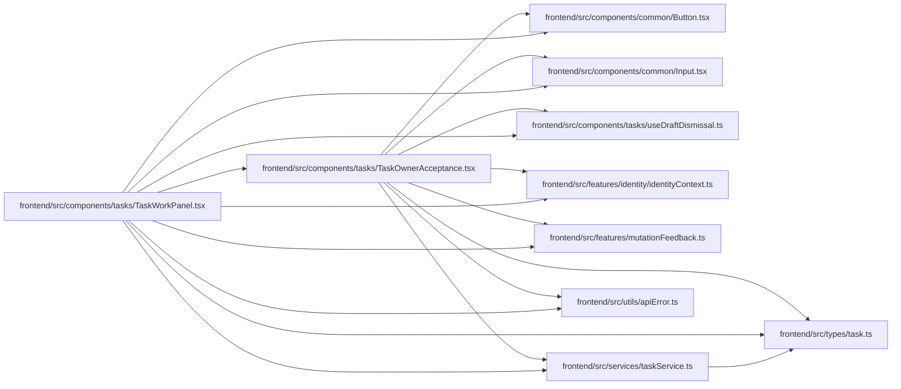

# TaskOwnerAcceptance Module

**Path:** `frontend/src/components/tasks/TaskOwnerAcceptance.tsx`

## Description

_Auto-generated from `frontend/src/components/tasks/TaskOwnerAcceptance.tsx`._

## Imports

| Source | Symbols | Type-only | Runtime emission |
|--------|---------|-----------|------------------|
| `../../features/identity/identityContext` | `useIdentity` | — | compiler-dependent |
| `../../features/mutationFeedback` | `MutationFeedbackMeta` | Declaration | erased |
| `../../services/taskService` | `taskService` | — | compiler-dependent |
| `../../types/task` | `Task` | Declaration | erased |
| `../../utils/apiError` | `getApiErrorMessage` | — | compiler-dependent |
| `../common/Button` | `Button` | — | compiler-dependent |
| `../common/Input` | `Input` | — | compiler-dependent |
| `./useDraftDismissal` | `useActiveMount` | — | compiler-dependent |
| `@tanstack/react-query` | `useMutation` | — | compiler-dependent |
| `react` | `useId`, `useState` | — | compiler-dependent |
| `react-i18next` | `useTranslation` | — | compiler-dependent |

## Module Signals

| Signal | Values |
|--------|--------|
| Exports | `TaskOwnerAcceptance`, `VERIFIED_PUBLISHER_CODE` |
| Constants | `VERIFIED_PUBLISHER_CODE` |

## Local dependency map

<!-- Auto-generated local dependency summary. Do not edit by hand. -->
This graph shows full source coupling. Type dependencies can be erased; compiler-dependent cycle groups are runtime candidates, not confirmed initialization cycles.

### Internal neighbors

| Direction | Module |
|---|---|
| Inbound | [TaskWorkPanel](../modules/TaskWorkPanel.md) |
| Outbound | [Button](../modules/Button.md) |
| Outbound | [Input](../modules/Input.md) |
| Outbound | [useDraftDismissal](../modules/useDraftDismissal.md) |
| Outbound | [identityContext](../modules/identityContext.md) |
| Outbound | [mutationFeedback](../modules/mutationFeedback.md) |
| Outbound | [taskService](../modules/taskService.md) |
| Outbound | [types_task](../modules/types_task.md) |
| Outbound | [apiError](../modules/apiError.md) |

### External packages

| Language | Used packages | Undeclared packages |
|---|---:|---:|
| typescript | 3 | 0 |

## Functions

| Function | Signature | Decorators | Description |
|----------|-----------|------------|-------------|
| `TaskOwnerAcceptance` | <pre><code>&#40;&#123; task&#44; disabled&#44; disabledReasons &#61; &#91;&#93;&#44; onPending&#44; onUpdated &#125;&#58; &#123;&#10;    task&#58; Task&#59; disabled&#58; boolean&#59; &#47;&#42;&#42; Why the action is disabled for a reason outside this form&#44; such as unsaved progress&#46; &#42;&#47; disabledReasons&#63;&#58; string&#91;&#93;&#59; onPending&#58; &#40;pending&#58; boolean&#41; &#61;&#62; void&#59; onUpdated&#58; &#40;task&#58; Task&#41; &#61;&#62; void&#59;&#10;&#125;&#41;</code></pre> | — | Accepting resolved work as an owner while the different-publisher policy stays on. Only a signed-in |
