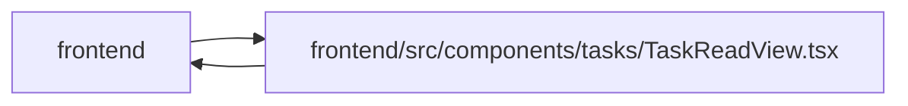

# TaskReadView Module

**Path:** `frontend/src/components/tasks/TaskReadView.tsx`

## Description

_Auto-generated from `frontend/src/components/tasks/TaskReadView.tsx`._

## Imports

| Source | Symbols | Type-only | Runtime emission |
|--------|---------|-----------|------------------|
| `../../services/taskService` | `taskService` | — | compiler-dependent |
| `../../types/task` | `Task`, `TaskBrief` | Declaration | erased |
| `../../utils/apiError` | `getApiErrorMessage` | — | compiler-dependent |
| `../../utils/formatDate` | `formatDate` | — | compiler-dependent |
| `../common/Button` | `Button` | — | compiler-dependent |
| `../feedback/toast` | `useToast` | — | compiler-dependent |
| `../ui/tone` | `pillToneClassName`, `STATUS_TONE` | — | compiler-dependent |
| `./DeliveryDependencies` | `DeliveryDependencies` | — | compiler-dependent |
| `./TaskBriefEditor` | `TaskBriefEditor` | — | compiler-dependent |
| `./TaskDiscussion` | `TaskDiscussion` | — | compiler-dependent |
| `./TaskTimelinePanel` | `TaskTimelinePanel` | — | compiler-dependent |
| `./TaskWorkPanel` | `TaskWorkPanel` | — | compiler-dependent |
| `./TimeEntriesPanel` | `TimeEntriesPanel` | — | compiler-dependent |
| `@tanstack/react-query` | `useMutation`, `useQueryClient` | — | compiler-dependent |
| `clsx` | `clsx` | — | compiler-dependent |
| `lucide-react` | `Link2`, `Pencil` | — | compiler-dependent |
| `react` | `useState` | — | compiler-dependent |
| `react-i18next` | `useTranslation` | — | compiler-dependent |
| `react-router-dom` | `useSearchParams` | — | compiler-dependent |

## Module Signals

| Signal | Values |
|--------|--------|
| Exports | `TASK_PART_PARAM`, `TaskReadView`, `TaskViewPart` |
| Constants | `TASK_PART_PARAM`, `PARTS`, `NEXT_TRANSITION` |

## Local dependency map

<!-- Auto-generated local dependency summary. Do not edit by hand. -->
This graph shows full source coupling. Type dependencies can be erased; compiler-dependent cycle groups are runtime candidates, not confirmed initialization cycles.

> Module-level dependencies exceed the generated-diagram limits, so the diagram and table below group them by top-level package. Counts report the number of module neighbors in each package.

### Internal neighbors

| Direction | Module |
|---|---|
| Inbound | `frontend` (3) |
| Outbound | `frontend` (13) |

### External packages

| Language | Used packages | Undeclared packages |
|---|---:|---:|
| typescript | 6 | 0 |

> All 16 module neighbor(s) are summarized by package because the module-level view exceeds the 12-node limit.

## Classes

| Class | Kind | Line | Bases / Target | Description |
|-------|------|------|----------------|-------------|
| [TaskViewPart](../entities/TaskViewPart.md) | Type alias | 21 | `'brief' \| 'work' \| 'activity'` | — |

## Functions

| Function | Signature | Decorators | Description |
|----------|-----------|------------|-------------|
| `TaskReadView` | <pre><code>&#40;&#123; task&#44; draftKey&#44; onTaskUpdated&#44; onEditAll&#44; onDirty&#44; onPending&#44; onReload &#125;&#58; &#123;&#10;    task&#58; Task&#59;&#10;    draftKey&#58; string &#124; null&#59;&#10;    onTaskUpdated&#58; &#40;task&#58; Task&#41; &#61;&#62; void&#59;&#10;    onEditAll&#58; &#40;&#41; &#61;&#62; void&#59;&#10;    onDirty&#58; &#40;dirty&#58; boolean&#41; &#61;&#62; void&#59;&#10;    onPending&#58; &#40;pending&#58; boolean&#41; &#61;&#62; void&#59;&#10;    onReload&#58; &#40;&#41; &#61;&#62; void&#59;&#10;&#125;&#41;</code></pre> | — | Read-first task view: Brief, Work & review, Activity. Nothing is an input |
