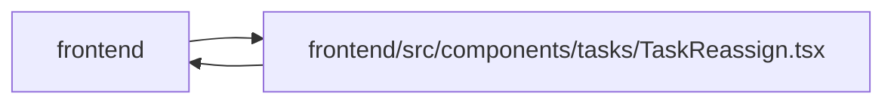

# TaskReassign Module

**Path:** `frontend/src/components/tasks/TaskReassign.tsx`

## Description

_Auto-generated from `frontend/src/components/tasks/TaskReassign.tsx`._

## Imports

| Source | Symbols | Type-only | Runtime emission |
|--------|---------|-----------|------------------|
| `../../services/taskService` | `taskService` | — | compiler-dependent |
| `../../types/task` | `RoutingCheck`, `TaskRoutingResolution`, `Task`, `TaskRouting` | Declaration | erased |
| `../../utils/apiError` | `getApiErrorMessage` | — | compiler-dependent |
| `../../utils/routingCheck` | `routingCheckFromError`, `routingNeedsResolution`, `routingShape` | — | compiler-dependent |
| `../common/Button` | `Button` | — | compiler-dependent |
| `../feedback/QueryState` | `QueryErrorState` | — | compiler-dependent |
| `../feedback/toast` | `useToast` | — | compiler-dependent |
| `./AssigneeSelect` | `AssigneeSelect` | — | compiler-dependent |
| `./RoutingCheckNotice` | `RoutingCheckNotice` | — | compiler-dependent |
| `./useTaskRowEdits` | `useAssigneeOptions` | — | compiler-dependent |
| `@tanstack/react-query` | `useMutation`, `useQuery`, `useQueryClient` | — | compiler-dependent |
| `react` | `useEffect`, `useRef`, `useState` | — | compiler-dependent |
| `react-i18next` | `useTranslation` | — | compiler-dependent |

## Module Signals

| Signal | Values |
|--------|--------|
| Exports | `TaskReassign` |

## Local dependency map

<!-- Auto-generated local dependency summary. Do not edit by hand. -->
This graph shows full source coupling. Type dependencies can be erased; compiler-dependent cycle groups are runtime candidates, not confirmed initialization cycles.

> Module-level dependencies exceed the generated-diagram limits, so the diagram and table below group them by top-level package. Counts report the number of module neighbors in each package.

### Internal neighbors

| Direction | Module |
|---|---|
| Inbound | `frontend` (2) |
| Outbound | `frontend` (10) |

### External packages

| Language | Used packages | Undeclared packages |
|---|---:|---:|
| typescript | 3 | 0 |

> All 12 module neighbor(s) are summarized by package because the module-level view exceeds the 12-node limit.

## Functions

| Function | Signature | Decorators | Description |
|----------|-----------|------------|-------------|
| `TaskReassign` | <pre><code>&#40;&#123; task&#44; disabled &#61; false&#44; focusOnMount &#61; false&#44; onTaskUpdated&#44; onPending&#44; onSaved &#125;&#58; &#123;&#10;    task&#58; Task&#59;&#10;    disabled&#63;&#58; boolean&#59;&#10;    onTaskUpdated&#58; &#40;task&#58; Task&#41; &#61;&#62; void&#59;&#10;    onPending&#58; &#40;pending&#58; boolean&#41; &#61;&#62; void&#59;&#10;    &#47;&#42;&#42; Put focus on the assignee control when this mounts&#44; after a save that replaced the view&#46; &#42;&#47;&#10;    focusOnMount&#63;&#58; boolean&#59;&#10;    &#47;&#42;&#42; The reassignment was saved&#59; called before the updated task is handed on&#46; &#42;&#47;&#10;    onSaved&#63;&#58; &#40;updated&#58; Task&#41; &#61;&#62; void&#59;&#10;&#125;&#41;</code></pre> | — | Reassigns one task from its page. Before anything is saved the server checks the task's |
