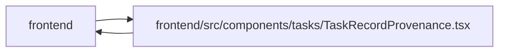

# TaskRecordProvenance Module

**Path:** `frontend/src/components/tasks/TaskRecordProvenance.tsx`

## Description

_Auto-generated from `frontend/src/components/tasks/TaskRecordProvenance.tsx`._

## Imports

| Source | Symbols | Type-only | Runtime emission |
|--------|---------|-----------|------------------|
| `../../features/identity/identityContext` | `useIdentity` | — | compiler-dependent |
| `../../features/mutationFeedback` | `MutationFeedbackMeta` | Declaration | erased |
| `../../services/taskService` | `taskService` | — | compiler-dependent |
| `../../types/task` | `ManualProvenanceExecutor`, `Task` | Declaration | erased |
| `../../utils/apiError` | `getApiErrorMessage`, `getApiNextStep` | — | compiler-dependent |
| `../common/Button` | `Button` | — | compiler-dependent |
| `../common/Input` | `Input` | — | compiler-dependent |
| `../common/Select` | `Select` | — | compiler-dependent |
| `../common/Textarea` | `Textarea` | — | compiler-dependent |
| `./RefusalNextStepNote` | `RefusalNextStepNote` | — | compiler-dependent |
| `./useDraftDismissal` | `useActiveMount` | — | compiler-dependent |
| `@tanstack/react-query` | `useMutation` | — | compiler-dependent |
| `react` | `useId`, `useState` | — | compiler-dependent |
| `react-i18next` | `useTranslation` | — | compiler-dependent |

## Module Signals

| Signal | Values |
|--------|--------|
| Exports | `TaskRecordProvenance` |

## Local dependency map

<!-- Auto-generated local dependency summary. Do not edit by hand. -->
This graph shows full source coupling. Type dependencies can be erased; compiler-dependent cycle groups are runtime candidates, not confirmed initialization cycles.

> Module-level dependencies exceed the generated-diagram limits, so the diagram and table below group them by top-level package. Counts report the number of module neighbors in each package.

### Internal neighbors

| Direction | Module |
|---|---|
| Inbound | `frontend` (1) |
| Outbound | `frontend` (11) |

### External packages

| Language | Used packages | Undeclared packages |
|---|---:|---:|
| typescript | 3 | 0 |

> All 12 module neighbor(s) are summarized by package because the module-level view exceeds the 12-node limit.

## Functions

| Function | Signature | Decorators | Description |
|----------|-----------|------------|-------------|
| `TaskRecordProvenance` | <pre><code>&#40;&#123; task&#44; disabled&#44; disabledReasons &#61; &#91;&#93;&#44; onPending&#44; onUpdated &#125;&#58; &#123;&#10;    task&#58; Task&#59; disabled&#58; boolean&#59; &#47;&#42;&#42; Why the action is disabled for a reason outside this form&#44; such as unsaved progress&#46; &#42;&#47; disabledReasons&#63;&#58; string&#91;&#93;&#59; onPending&#58; &#40;pending&#58; boolean&#41; &#61;&#62; void&#59; onUpdated&#58; &#40;task&#58; Task&#41; &#61;&#62; void&#59;&#10;&#125;&#41;</code></pre> | — | Recording who executed resolved work that was delivered outside recorded runs, and the exact commits they delivered, |
