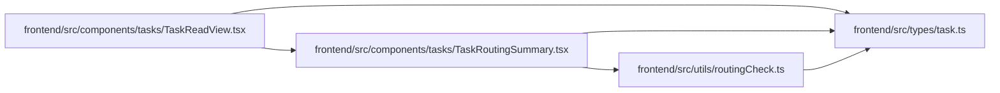

# TaskRoutingSummary Module

**Path:** `frontend/src/components/tasks/TaskRoutingSummary.tsx`

## Description

_Auto-generated from `frontend/src/components/tasks/TaskRoutingSummary.tsx`._

## Imports

| Source | Symbols | Type-only | Runtime emission |
|--------|---------|-----------|------------------|
| `../../types/task` | `TaskRouting` | Declaration | erased |
| `../../utils/routingCheck` | `rungLabel` | — | compiler-dependent |
| `react-i18next` | `useTranslation` | — | compiler-dependent |

## Module Signals

| Signal | Values |
|--------|--------|
| Exports | `TaskRoutingSummary` |

## Local dependency map

<!-- Auto-generated local dependency summary. Do not edit by hand. -->
This graph shows full source coupling. Type dependencies can be erased; compiler-dependent cycle groups are runtime candidates, not confirmed initialization cycles.

### Internal neighbors

| Direction | Module |
|---|---|
| Inbound | [TaskReadView](../modules/TaskReadView.md) |
| Outbound | [types_task](../modules/types_task.md) |
| Outbound | [routingCheck](../modules/routingCheck.md) |

### External packages

| Language | Used packages | Undeclared packages |
|---|---:|---:|
| typescript | 1 | 0 |

## Functions

| Function | Signature | Decorators | Description |
|----------|-----------|------------|-------------|
| `TaskRoutingSummary` | `({ routing }: { routing: TaskRouting \| null \| undefined })` | — | The structured routing of a task: who runs it first, when it escalates and who reviews it. |
