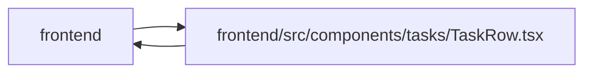

# TaskRow Module

**Path:** `frontend/src/components/tasks/TaskRow.tsx`

## Description

_Auto-generated from `frontend/src/components/tasks/TaskRow.tsx`._

## Imports

| Source | Symbols | Type-only | Runtime emission |
|--------|---------|-----------|------------------|
| `../../components/common/Button` | `Button` | — | compiler-dependent |
| `../../features/agentDispatch` | `AgentDispatchState` | Declaration | erased |
| `../../features/taskTransitions` | `canTransition`, `TASK_TRANSITIONS` | — | compiler-dependent |
| `../../types/task` | `TaskDisplayedState`, `TaskStatus` | Declaration | erased |
| `../../utils/taskState` | `isEndedState`, `isStoppedState` | — | compiler-dependent |
| `../ui/OverflowMenu` | `OverflowMenuItem` | Declaration | erased |
| `../ui/OverflowMenu` | `OverflowMenu` | — | compiler-dependent |
| `../ui/tone` | `pillToneClassName`, `STATE_TONE`, `stateTextClassName` | — | compiler-dependent |
| `./AssigneeSelect` | `AssigneeSelect` | — | compiler-dependent |
| `./taskRowParts` | `AgentDispatchLine`, `AssigneeKindIcon`, `EffortValue`, `TaskStateChipBadge` | — | compiler-dependent |
| `./taskStateChip` | `TaskStateChip` | Declaration | erased |
| `./taskStateChip` | `isDone` | — | compiler-dependent |
| `clsx` | `clsx` | — | compiler-dependent |
| `lucide-react` | `ArrowRightCircle`, `CheckCircle2`, `Circle`, `CornerDownRight`, `PauseCircle`, `XCircle` | — | compiler-dependent |
| `react` | `ReactNode` | Declaration | erased |
| `react` | `useId`, `useState` | — | compiler-dependent |
| `react-i18next` | `useTranslation` | — | compiler-dependent |

## Module Signals

| Signal | Values |
|--------|--------|
| Exports | `TaskRow`, `TaskRowAssigneeOption`, `TaskRowProps` |

## Local dependency map

<!-- Auto-generated local dependency summary. Do not edit by hand. -->
This graph shows full source coupling. Type dependencies can be erased; compiler-dependent cycle groups are runtime candidates, not confirmed initialization cycles.

> Module-level dependencies exceed the generated-diagram limits, so the diagram and table below group them by top-level package. Counts report the number of module neighbors in each package.

### Internal neighbors

| Direction | Module |
|---|---|
| Inbound | `frontend` (10) |
| Outbound | `frontend` (10) |

### External packages

| Language | Used packages | Undeclared packages |
|---|---:|---:|
| typescript | 4 | 0 |

> All 19 module neighbor(s) are summarized by package because the module-level view exceeds the 12-node limit.

## Classes

| Class | Kind | Line | Bases / Target | Description |
|-------|------|------|----------------|-------------|
| [TaskRowAssigneeOption](../entities/TaskRowAssigneeOption.md) | Interface | 19 | — | — |
| [TaskRowProps](../entities/TaskRowProps.md) | Interface | 21 | — | — |

## Functions

| Function | Signature | Decorators | Description |
|----------|-----------|------------|-------------|
| `TaskRow` | <pre><code>&#40;&#123;&#10;    id&#44; title&#44; titleText&#44; status&#44; state&#58; shownState&#44; successor&#44; statusLocked &#61; false&#44; priority&#44; chip&#44; meta&#44; reasons&#44; assignee&#44; assigneeOptions&#44; onAssign&#44; effort&#44;&#10;    level &#61; 0&#44; lead&#44; handle&#44; revealed &#61; false&#44; onOpen&#44; onStatusChange&#44; menuItems&#44; selected &#61; false&#44; onToggleSelect&#44; selectDisabledReason&#44; dispatch&#44; reviewer&#44;&#10;    overdue &#61; false&#44; deferred &#61; false&#44; className&#44;&#10;&#125;&#58; TaskRowProps&#41;</code></pre> | — | One 44 px task row for the list, My Work and the project task tree. At rest it holds the |
