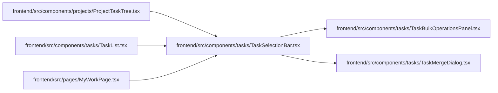

# TaskSelectionBar Module

**Path:** `frontend/src/components/tasks/TaskSelectionBar.tsx`

## Description

_Auto-generated from `frontend/src/components/tasks/TaskSelectionBar.tsx`._

## Imports

| Source | Symbols | Type-only | Runtime emission |
|--------|---------|-----------|------------------|
| `./TaskBulkOperationsPanel` | `BulkSelectedTask` | Declaration | erased |
| `./TaskBulkOperationsPanel` | `TaskBulkOperationsPanel` | — | compiler-dependent |
| `./TaskMergeDialog` | `TaskMergeDialog` | — | compiler-dependent |
| `react` | `useState` | — | compiler-dependent |

## Module Signals

| Signal | Values |
|--------|--------|
| Exports | `TaskSelectionBar` |

## Local dependency map

<!-- Auto-generated local dependency summary. Do not edit by hand. -->
This graph shows full source coupling. Type dependencies can be erased; compiler-dependent cycle groups are runtime candidates, not confirmed initialization cycles.

### Internal neighbors

| Direction | Module |
|---|---|
| Inbound | [ProjectTaskTree](../modules/ProjectTaskTree.md) |
| Inbound | [TaskList](../modules/TaskList.md) |
| Inbound | [MyWorkPage](../modules/MyWorkPage.md) |
| Outbound | [TaskBulkOperationsPanel](../modules/TaskBulkOperationsPanel.md) |
| Outbound | [TaskMergeDialog](../modules/TaskMergeDialog.md) |

### External packages

| Language | Used packages | Undeclared packages |
|---|---:|---:|
| typescript | 1 | 0 |

## Classes

| Class | Kind | Line | Bases / Target | Description |
|-------|------|------|----------------|-------------|
| [TaskSelectionBarProps](../entities/TaskSelectionBarProps.md) | Interface | 6 | — | — |

## Functions

| Function | Signature | Decorators | Description |
|----------|-----------|------------|-------------|
| `TaskSelectionBar` | `({ iterationId, selectedTasks, matchingCount, onSelectAll, onClearSelection, openAssign }: TaskSelectionBarProps)` | — | The sticky bulk bar with its merge dialog, for any list of task rows that can be selected. |
