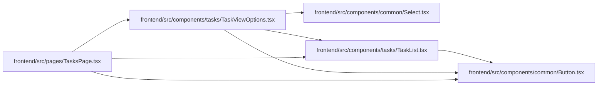

# TaskViewOptions Module

**Path:** `frontend/src/components/tasks/TaskViewOptions.tsx`

## Description

_Auto-generated from `frontend/src/components/tasks/TaskViewOptions.tsx`._

## Imports

| Source | Symbols | Type-only | Runtime emission |
|--------|---------|-----------|------------------|
| `../../components/common/Button` | `Button` | — | compiler-dependent |
| `../common/Select` | `Select` | — | compiler-dependent |
| `./TaskList` | `SortKey` | Declaration | erased |
| `lucide-react` | `SlidersHorizontal` | — | compiler-dependent |
| `react` | `useEffect`, `useId`, `useRef`, `useState` | — | compiler-dependent |
| `react-i18next` | `useTranslation` | — | compiler-dependent |

## Module Signals

| Signal | Values |
|--------|--------|
| Exports | `TaskViewOptions` |

## Local dependency map

<!-- Auto-generated local dependency summary. Do not edit by hand. -->
This graph shows full source coupling. Type dependencies can be erased; compiler-dependent cycle groups are runtime candidates, not confirmed initialization cycles.

### Internal neighbors

| Direction | Module |
|---|---|
| Inbound | [TasksPage](../modules/TasksPage.md) |
| Outbound | [Button](../modules/Button.md) |
| Outbound | [Select](../modules/Select.md) |
| Outbound | [TaskList](../modules/TaskList.md) |

### External packages

| Language | Used packages | Undeclared packages |
|---|---:|---:|
| typescript | 3 | 0 |

## Functions

| Function | Signature | Decorators | Description |
|----------|-----------|------------|-------------|
| `TaskViewOptions` | <pre><code>&#40;&#123; sortKey&#44; onSortKeyChange&#44; groupByStatus&#44; onGroupByStatusChange &#125;&#58; &#123;&#10;    sortKey&#58; SortKey&#59;&#10;    onSortKeyChange&#58; &#40;sortKey&#58; SortKey&#41; &#61;&#62; void&#59;&#10;    groupByStatus&#58; boolean&#59;&#10;    onGroupByStatusChange&#58; &#40;groupByStatus&#58; boolean&#41; &#61;&#62; void&#59;&#10;&#125;&#41;</code></pre> | — | How the task list is arranged: grouping and order, in one popover next to the view switch. The trigger is an |
