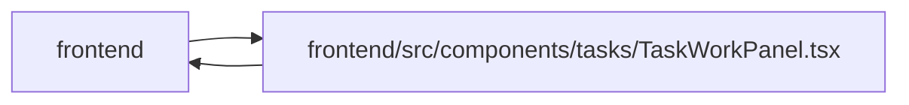

# TaskWorkPanel Module

**Path:** `frontend/src/components/tasks/TaskWorkPanel.tsx`

## Description

Commit and uncommit commands retain original source and selected-target aggregate maps with command input. Scope conflicts preserve the reason and map until explicit current comparison. Obsolete request callbacks cannot clear replacement drafts or pending state.

## Imports

| Source | Symbols | Type-only | Runtime emission |
|--------|---------|-----------|------------------|
| `../../features/usePlanningObservation` | `usePlanningObservation` | — | compiler-dependent |
| `../../services/iterationService` | `iterationService` | — | compiler-dependent |
| `../../services/planningInputService` | `ObservedRevisions` | Declaration | erased |
| `../../services/planningInputService` | `planningInputService` | — | compiler-dependent |
| `../../services/taskService` | `taskService` | — | compiler-dependent |
| `../../types/iteration` | `Iteration` | Declaration | erased |
| `../../types/task` | `CriterionProgress`, `Task` | Declaration | erased |
| `../../utils/apiError` | `getApiErrorMessage` | — | compiler-dependent |
| `../common/Button` | `Button` | — | compiler-dependent |
| `../common/Input` | `Input` | — | compiler-dependent |
| `../feedback/QueryState` | `QueryErrorState`, `QueryLoadingState` | — | compiler-dependent |
| `./TaskReviewer` | `TaskReviewer` | — | compiler-dependent |
| `./useDraftDismissal` | `useActiveMount` | — | compiler-dependent |
| `@tanstack/react-query` | `useMutation`, `useQuery` | — | compiler-dependent |
| `react` | `useEffect`, `useId`, `useState` | — | compiler-dependent |
| `react-i18next` | `useTranslation` | — | compiler-dependent |

## Module Signals

| Signal | Values |
|--------|--------|
| Exports | `TaskWorkPanel` |

## Local dependency map

<!-- Auto-generated local dependency summary. Do not edit by hand. -->
This graph shows full source coupling. Type dependencies can be erased; compiler-dependent cycle groups are runtime candidates, not confirmed initialization cycles.

> Module-level dependencies exceed the generated-diagram limits, so the diagram and table below group them by top-level package. Counts report the number of module neighbors in each package.

### Internal neighbors

| Direction | Module |
|---|---|
| Inbound | `frontend` (2) |
| Outbound | `frontend` (12) |

### External packages

| Language | Used packages | Undeclared packages |
|---|---:|---:|
| typescript | 3 | 0 |

> All 14 module neighbor(s) are summarized by package because the module-level view exceeds the 12-node limit.

## Functions

| Function | Signature | Decorators | Description |
|----------|-----------|------------|-------------|
| `TaskWorkPanel` | <pre><code>&#40;&#123; task&#44; disabled&#44; draftKey&#44; onDirty&#44; onPending&#44; onUpdated&#44; onReload &#125;&#58; &#123;&#10;    task&#58; Task&#59; disabled&#58; boolean&#59; draftKey&#58; string &#124; null&#59; onDirty&#58; &#40;dirty&#58; boolean&#41; &#61;&#62; void&#59;&#10;    onPending&#58; &#40;pending&#58; boolean&#41; &#61;&#62; void&#59; onUpdated&#58; &#40;task&#58; Task&#41; &#61;&#62; void&#59; onReload&#58; &#40;&#41; &#61;&#62; void&#59;&#10;&#125;&#41;</code></pre> | — | — |