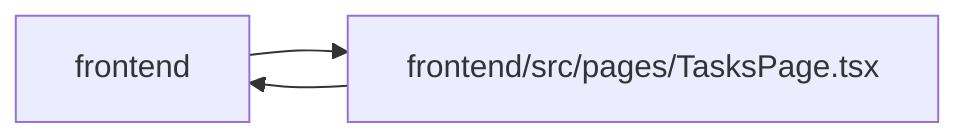

# TasksPage Module

**Path:** `frontend/src/pages/TasksPage.tsx`

## Description

The layout parameter selects the list, board or agent pipeline. The iteration selection can instead place the task browser in backlog scope. The pipeline loads supervision data only while that layout is active. Opening a task retains the filters and focused task in the URL.

## Imports

| Source | Symbols | Type-only | Runtime emission |
|--------|---------|-----------|------------------|
| `../components/common/Button` | `Button` | — | compiler-dependent |
| `../components/common/ButtonLink` | `ButtonLink` | — | compiler-dependent |
| `../components/common/FullscreenWorkspace` | `FullscreenWorkspace` | — | compiler-dependent |
| `../components/common/Input` | `Input` | — | compiler-dependent |
| `../components/feedback/QueryState` | `QueryErrorState`, `QueryLoadingState` | — | compiler-dependent |
| `../components/overview/OverviewTaskReturnBar` | `OverviewTaskReturnBar` | — | compiler-dependent |
| `../components/planning/PlanReturnBar` | `PlanReturnBar` | — | compiler-dependent |
| `../components/tasks/AtRiskTaskReasons` | `AtRiskTaskReasons` | — | compiler-dependent |
| `../components/tasks/BacklogPanel` | `BacklogPanel` | — | compiler-dependent |
| `../components/tasks/GuardedTaskDrawer` | `GuardedTaskDrawer` | — | compiler-dependent |
| `../components/tasks/ImportTasksModal` | `ImportTasksModal` | — | compiler-dependent |
| `../components/tasks/KanbanBoard/KanbanBoard` | `KanbanBoard` | — | compiler-dependent |
| `../components/tasks/PipelineTaskEvidence` | `PipelineTaskEvidence` | — | compiler-dependent |
| `../components/tasks/PipelineView` | `PipelineView` | — | compiler-dependent |
| `../components/tasks/QuickCapture` | `QuickCapture` | — | compiler-dependent |
| `../components/tasks/SavedViewsControl` | `SavedViewPicker` | — | compiler-dependent |
| `../components/tasks/TaskEditorDrawer` | `TaskEditorDrawer` | — | compiler-dependent |
| `../components/tasks/TaskFiltersBar` | `TaskFilters` | Declaration | erased |
| `../components/tasks/TaskFiltersBar` | `TaskFiltersBar` | — | compiler-dependent |
| `../components/tasks/TaskList` | `SortKey`, `TaskMode` | Declaration | erased |
| `../components/tasks/TaskList` | `TaskList` | — | compiler-dependent |
| `../components/tasks/TaskReadView` | `TASK_PART_PARAM` | — | compiler-dependent |
| `../components/tasks/TaskTextEditorModal` | `TaskTextEditorModal` | — | compiler-dependent |
| `../components/tasks/TaskViewOptions` | `TaskViewOptions` | — | compiler-dependent |
| `../components/tasks/usePipeline` | `usePipeline` | — | compiler-dependent |
| `../components/tasks/useSavedViewManager` | `useSavedViewManager` | — | compiler-dependent |
| `../components/ui` | `PageHeader`, `PageLayout`, `PageToolbar`, `ViewSwitch` | — | compiler-dependent |
| `../features/firstRun/NextStepEmptyState` | `NextStepEmptyState` | — | compiler-dependent |
| `../features/firstRun/firstRunSteps` | `firstRunPlanHref` | — | compiler-dependent |
| `../features/firstRun/useFirstRunProgress` | `useFirstRunProgress` | — | compiler-dependent |
| `../features/overview/overviewTaskThread` | `OVERVIEW_TASK_ORIGIN`, `OVERVIEW_TASK_ORIGIN_PARAM`, `OVERVIEW_TASK_PARAM`, `OVERVIEW_TASK_RETURN_PARAM`, `OVERVIEW_TASK_THREAD_PARAM`, `overviewTaskThreadSource`, `positiveTaskId` | — | compiler-dependent |
| `../features/planningMasters/planningReturn` | `PLANNING_RETURN_STEP_PARAM` | — | compiler-dependent |
| `../features/planningMasters/planningTaskIssues` | `PLANNING_ITERATION_PARAM`, `PLANNING_TASK_ISSUE_PARAM`, `parsePlanningIterationId`, `parsePlanningTaskIssue` | — | compiler-dependent |
| `../features/savedViews/taskViewParams` | `activeFilterCount`, `filtersFromSearchParams`, `groupByStatusFromSearchParams`, `searchParamsNameView`, `sortKeyFromSearchParams`, `TASK_CLEARED_VIEW_PARAM`, `TASK_FILTER_PARAMS`, `TASK_GROUP_PARAM`, `TASK_SORT_PARAM`, `writeClearedViewMarker`, `writeFiltersToSearchParams`, `writeSortKeyToSearchParams` | — | compiler-dependent |
| `../features/savedViews/taskViewState` | `filtersFromSavedView`, `sortKeyFromSavedView` | — | compiler-dependent |
| `../features/scope/namedIteration` | `urlNamesIteration` | — | compiler-dependent |
| `../features/scope/useScopeLink` | `useLinkScope`, `useScopeLink` | — | compiler-dependent |
| `../features/scope/useWorkScope` | `useWorkScope` | — | compiler-dependent |
| `../features/scope/workScope` | `ScopeIteration` | Specifier | compiler-dependent |
| `../features/scope/workScope` | `resolveWorkScope` | — | compiler-dependent |
| `../i18n/seedDisplay` | `savedViewDisplay` | — | compiler-dependent |
| `../services/iterationService` | `iterationService` | — | compiler-dependent |
| `../services/labelService` | `labelService` | — | compiler-dependent |
| `../services/savedViewService` | `savedViewService` | — | compiler-dependent |
| `../services/taskService` | `taskService` | — | compiler-dependent |
| `../types/savedView` | `SavedView` | Declaration | erased |
| `../types/task` | `Task` | Declaration | erased |
| `../utils/taskFilterDefaults` | `defaultFilters` | — | compiler-dependent |
| `@tanstack/react-query` | `useQuery`, `useQueryClient` | — | compiler-dependent |
| `clsx` | `clsx` | — | compiler-dependent |
| `lucide-react` | `AlertTriangle`, `Bot`, `FileText`, `LayoutGrid`, `List`, `Maximize2`, `Minimize2`, `Plus`, `Search`, `Upload`, `Waypoints`, `X` | — | compiler-dependent |
| `react` | `ReactNode` | Declaration | erased |
| `react` | `useCallback`, `useEffect`, `useMemo`, `useRef`, `useState` | — | compiler-dependent |
| `react-i18next` | `useTranslation` | — | compiler-dependent |
| `react-router-dom` | `useLocation`, `useSearchParams` | — | compiler-dependent |

## Module Signals

| Signal | Values |
|--------|--------|
| Exports | `default` |
| Constants | `VIEW_PARAM`, `SEARCH_PARAM` |

## Local dependency map

<!-- Auto-generated local dependency summary. Do not edit by hand. -->
This graph shows full source coupling. Type dependencies can be erased; compiler-dependent cycle groups are runtime candidates, not confirmed initialization cycles.

> Module-level dependencies exceed the generated-diagram limits, so the diagram and table below group them by top-level package. Counts report the number of module neighbors in each package.

### Internal neighbors

| Direction | Module |
|---|---|
| Inbound | `frontend` (9) |
| Outbound | `frontend` (45) |

### External packages

| Language | Used packages | Undeclared packages |
|---|---:|---:|
| typescript | 6 | 0 |

> All 54 module neighbor(s) are summarized by package because the module-level view exceeds the 12-node limit.

## Classes

| Class | Kind | Line | Bases / Target | Description |
|-------|------|------|----------------|-------------|
| [ViewMode](../entities/ViewMode.md) | Type alias | 95 | `'list' \| 'board' \| 'pipeline'` | — |
