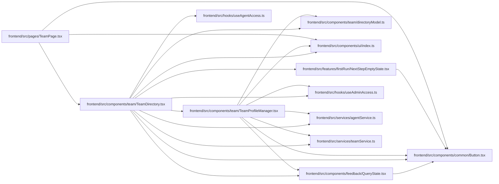

# TeamDirectory Module

**Path:** `frontend/src/components/team/TeamDirectory.tsx`

## Description

_Auto-generated from `frontend/src/components/team/TeamDirectory.tsx`._

## Imports

| Source | Symbols | Type-only | Runtime emission |
|--------|---------|-----------|------------------|
| `../../features/firstRun/NextStepEmptyState` | `NextStepEmptyState` | — | compiler-dependent |
| `../../hooks/useAdminAccess` | `useAdminAccess` | — | compiler-dependent |
| `../../hooks/useAgentAccess` | `useAgentAccess` | — | compiler-dependent |
| `../../services/agentService` | `agentService` | — | compiler-dependent |
| `../../services/teamService` | `teamService` | — | compiler-dependent |
| `../common/Button` | `Button` | — | compiler-dependent |
| `../feedback/QueryState` | `QueryErrorState`, `QueryLoadingState` | — | compiler-dependent |
| `../ui` | `PillTone` | Declaration | erased |
| `../ui` | `Pill`, `TableFrame` | — | compiler-dependent |
| `./TeamProfileManager` | `TeamProfileManager` | — | compiler-dependent |
| `./directoryModel` | `AgentStatus`, `ConnectionState`, `DirectoryActor`, `DirectoryRow`, `RosterState` | Specifier | compiler-dependent |
| `./directoryModel` | `actorName`, `buildDirectory`, `distinctRole`, `modelName` | — | compiler-dependent |
| `@tanstack/react-query` | `useQuery` | — | compiler-dependent |
| `lucide-react` | `Bot`, `User` | — | compiler-dependent |
| `react` | `ReactNode`, `RefObject` | Specifier | compiler-dependent |
| `react` | `useEffect`, `useMemo`, `useState` | — | compiler-dependent |
| `react-i18next` | `useTranslation` | — | compiler-dependent |

## Module Signals

| Signal | Values |
|--------|--------|
| Exports | `DrawerTarget`, `TeamDirectory` |
| Constants | `MAX_CHIPS`, `CLOCK_TICK_MS`, `CONNECTION_TONE` |

## Local dependency map

<!-- Auto-generated local dependency summary. Do not edit by hand. -->
This graph shows full source coupling. Type dependencies can be erased; compiler-dependent cycle groups are runtime candidates, not confirmed initialization cycles.

### Internal neighbors

| Direction | Module |
|---|---|
| Inbound | [TeamPage](../modules/TeamPage.md) |
| Outbound | [Button](../modules/Button.md) |
| Outbound | [QueryState](../modules/QueryState.md) |
| Outbound | [directoryModel](../modules/directoryModel.md) |
| Outbound | [TeamProfileManager](../modules/TeamProfileManager.md) |
| Outbound | [index](../modules/index.md) |
| Outbound | [NextStepEmptyState](../modules/NextStepEmptyState.md) |
| Outbound | [useAdminAccess](../modules/useAdminAccess.md) |
| Outbound | [useAgentAccess](../modules/useAgentAccess.md) |
| Outbound | [agentService](../modules/agentService.md) |
| Outbound | [teamService](../modules/teamService.md) |

### External packages

| Language | Used packages | Undeclared packages |
|---|---:|---:|
| typescript | 4 | 0 |

## Classes

| Class | Kind | Line | Bases / Target | Description |
|-------|------|------|----------------|-------------|
| [DrawerTarget](../entities/DrawerTarget.md) | Type alias | 44 | `{ mode: 'add' } \| { mode: 'edit'; key: string } \| null` | — |

## Functions

| Function | Signature | Decorators | Description |
|----------|-----------|------------|-------------|
| `TeamDirectory` | <pre><code>&#40;&#123; drawer&#44; onDrawerChange&#44; onEmptyChange&#44; drawerFallbackFocusRef &#125;&#58; &#123;&#10;    drawer&#58; DrawerTarget&#59;&#10;    onDrawerChange&#58; &#40;target&#58; DrawerTarget&#41; &#61;&#62; void&#59;&#10;    onEmptyChange&#63;&#58; &#40;empty&#58; boolean&#41; &#61;&#62; void&#59;&#10;    &#47;&#42;&#42; Where focus goes when the drawer closes and the control that opened it is gone&#46; &#42;&#47;&#10;    drawerFallbackFocusRef&#63;&#58; RefObject&#60;HTMLElement &#124; null&#62;&#59;&#10;&#125;&#41;</code></pre> | — | Everyone who can do work in one table; a row opens the drawer for that person or agent. |
