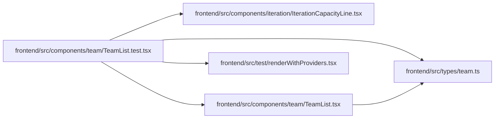

# TeamList.test Module

**Path:** `frontend/src/components/team/TeamList.test.tsx`

## Description

_Auto-generated from `frontend/src/components/team/TeamList.test.tsx`._

## Imports

| Source | Symbols | Type-only | Runtime emission |
|--------|---------|-----------|------------------|
| `../../test/renderWithProviders` | `renderWithProviders` | — | compiler-dependent |
| `../../types/team` | `TeamMember` | Declaration | erased |
| `../iteration/IterationCapacityLine` | `IterationCapacityLine` | — | compiler-dependent |
| `./TeamList` | `TeamList` | — | compiler-dependent |
| `@testing-library/react` | `screen` | — | compiler-dependent |
| `vitest` | `describe`, `expect`, `it`, `vi` | — | compiler-dependent |

## Module Signals

| Signal | Values |
|--------|--------|
| Constants | `team`, `iterations` |
| Module calls | `team = hoisted`, `mock`, `iterations = hoisted`, `mock`, `describe` |

## Local dependency map

<!-- Auto-generated local dependency summary. Do not edit by hand. -->
This graph shows full source coupling. Type dependencies can be erased; compiler-dependent cycle groups are runtime candidates, not confirmed initialization cycles.

### Internal neighbors

| Direction | Module |
|---|---|
| Outbound | [IterationCapacityLine](../modules/IterationCapacityLine.md) |
| Outbound | [TeamList](../modules/TeamList.md) |
| Outbound | [renderWithProviders](../modules/renderWithProviders.md) |
| Outbound | [types_team](../modules/types_team.md) |

### External packages

| Language | Used packages | Undeclared packages |
|---|---:|---:|
| typescript | 2 | 0 |
