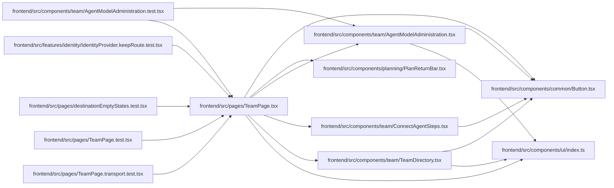

# TeamPage Module

**Path:** `frontend/src/pages/TeamPage.tsx`

## Description

The Team tabs share the current URL. Members opens the people and agent directory, Models manages catalog entries and actor bindings, and Connect guides the operator through team setup. The active tab supplies its own header action. Returning to Plan keeps the iteration context.

## Imports

| Source | Symbols | Type-only | Runtime emission |
|--------|---------|-----------|------------------|
| `../components/common/Button` | `Button` | — | compiler-dependent |
| `../components/planning/PlanReturnBar` | `PlanReturnBar` | — | compiler-dependent |
| `../components/team/AgentModelAdministration` | `ModelHeaderActions` | Specifier | compiler-dependent |
| `../components/team/AgentModelAdministration` | `AgentModelAdministration` | — | compiler-dependent |
| `../components/team/ConnectAgentSteps` | `ConnectAgentSteps` | — | compiler-dependent |
| `../components/team/TeamDirectory` | `DrawerTarget` | Specifier | compiler-dependent |
| `../components/team/TeamDirectory` | `TeamDirectory` | — | compiler-dependent |
| `../components/ui` | `PageHeader`, `PageLayout` | — | compiler-dependent |
| `clsx` | `clsx` | — | compiler-dependent |
| `lucide-react` | `Plus` | — | compiler-dependent |
| `react` | `useRef`, `useState` | — | compiler-dependent |
| `react-i18next` | `useTranslation` | — | compiler-dependent |
| `react-router-dom` | `Link`, `useSearchParams` | — | compiler-dependent |

## Module Signals

| Signal | Values |
|--------|--------|
| Exports | `default` |
| Constants | `TEAM_TABS` |

## Local dependency map

<!-- Auto-generated local dependency summary. Do not edit by hand. -->
This graph shows full source coupling. Type dependencies can be erased; compiler-dependent cycle groups are runtime candidates, not confirmed initialization cycles.

### Internal neighbors

| Direction | Module |
|---|---|
| Inbound | [AgentModelAdministration.test](../modules/AgentModelAdministration.test.md) |
| Inbound | [IdentityProvider.keepRoute.test](../modules/IdentityProvider.keepRoute.test.md) |
| Inbound | [destinationEmptyStates.test](../modules/destinationEmptyStates.test.md) |
| Inbound | [TeamPage.test](../modules/TeamPage.test.md) |
| Inbound | [TeamPage.transport.test](../modules/TeamPage.transport.test.md) |
| Outbound | [Button](../modules/Button.md) |
| Outbound | [PlanReturnBar](../modules/PlanReturnBar.md) |
| Outbound | [AgentModelAdministration](../modules/AgentModelAdministration.md) |
| Outbound | [ConnectAgentSteps](../modules/ConnectAgentSteps.md) |
| Outbound | [TeamDirectory](../modules/TeamDirectory.md) |
| Outbound | [index](../modules/index.md) |

### External packages

| Language | Used packages | Undeclared packages |
|---|---:|---:|
| typescript | 5 | 0 |

## Classes

| Class | Kind | Line | Bases / Target | Description |
|-------|------|------|----------------|-------------|
| [TeamTab](../entities/TeamTab.md) | Type alias | 14 | `(typeof TEAM_TABS)[number]` | — |
