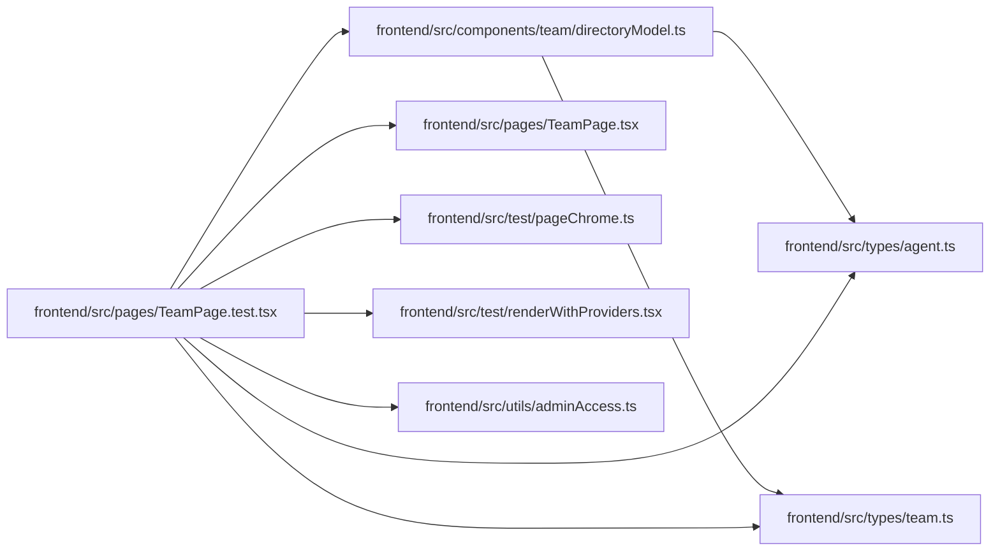

# TeamPage.test Module

**Path:** `frontend/src/pages/TeamPage.test.tsx`

## Description

_Auto-generated from `frontend/src/pages/TeamPage.test.tsx`._

## Imports

| Source | Symbols | Type-only | Runtime emission |
|--------|---------|-----------|------------------|
| `../components/team/directoryModel` | `CONNECTED_WINDOW_MS` | — | compiler-dependent |
| `../test/pageChrome` | `expectPageChrome` | — | compiler-dependent |
| `../test/renderWithProviders` | `renderWithProviders` | — | compiler-dependent |
| `../types/agent` | `AgentActorRosterItem`, `AgentModelBinding` | Declaration | erased |
| `../types/team` | `TeamMemberProfile`, `TeamMemberProfileSkill` | Declaration | erased |
| `../utils/adminAccess` | `clearAdminApiKey`, `setAdminApiKey` | — | compiler-dependent |
| `./TeamPage` | `TeamPage` | — | compiler-dependent |
| `@testing-library/react` | `act`, `screen`, `waitFor`, `within` | — | compiler-dependent |
| `vitest` | `afterEach`, `beforeEach`, `describe`, `expect`, `it`, `vi` | — | compiler-dependent |

## Module Signals

| Signal | Values |
|--------|--------|
| Constants | `services`, `binding`, `PEOPLE` |
| Module calls | `services = hoisted`, `mock`, `mock`, `mock`, `describe` |

## Local dependency map

<!-- Auto-generated local dependency summary. Do not edit by hand. -->
This graph shows full source coupling. Type dependencies can be erased; compiler-dependent cycle groups are runtime candidates, not confirmed initialization cycles.

### Internal neighbors

| Direction | Module |
|---|---|
| Outbound | [directoryModel](../modules/directoryModel.md) |
| Outbound | [TeamPage](../modules/TeamPage.md) |
| Outbound | [pageChrome](../modules/pageChrome.md) |
| Outbound | [renderWithProviders](../modules/renderWithProviders.md) |
| Outbound | [types_agent](../modules/types_agent.md) |
| Outbound | [types_team](../modules/types_team.md) |
| Outbound | [adminAccess](../modules/adminAccess.md) |

### External packages

| Language | Used packages | Undeclared packages |
|---|---:|---:|
| typescript | 2 | 0 |
