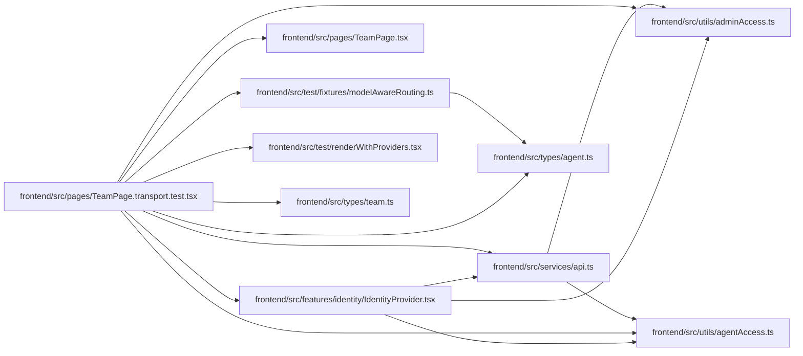

# TeamPage.transport.test Module

**Path:** `frontend/src/pages/TeamPage.transport.test.tsx`

## Description

_Auto-generated from `frontend/src/pages/TeamPage.transport.test.tsx`._

## Imports

| Source | Symbols | Type-only | Runtime emission |
|--------|---------|-----------|------------------|
| `../features/identity/IdentityProvider` | `IdentityProvider` | — | compiler-dependent |
| `../services/api` | `api`, `IDENTITY_EXPIRED_EVENT` | — | compiler-dependent |
| `../test/fixtures/modelAwareRouting` | `modelAwareRoutingRoster` | — | compiler-dependent |
| `../test/renderWithProviders` | `renderWithProviders` | — | compiler-dependent |
| `../types/agent` | `AgentModelBinding`, `AgentModelCatalogEntry` | Declaration | erased |
| `../types/team` | `TeamMemberProfile` | Declaration | erased |
| `../utils/adminAccess` | `clearAdminApiKey`, `setAdminApiKey` | — | compiler-dependent |
| `../utils/agentAccess` | `clearAgentApiKey`, `setAgentApiKey` | — | compiler-dependent |
| `./TeamPage` | `TeamPage` | — | compiler-dependent |
| `@testing-library/react` | `screen`, `waitFor`, `within` | — | compiler-dependent |
| `axios` | `AxiosAdapter`, `AxiosResponse`, `InternalAxiosRequestConfig` | Declaration | erased |
| `axios` | `AxiosError` | — | compiler-dependent |
| `vitest` | `afterEach`, `beforeEach`, `describe`, `expect`, `it`, `vi` | — | compiler-dependent |

## Module Signals

| Signal | Values |
|--------|--------|
| Constants | `services`, `originalAdapter`, `EXPIRED_TEXT`, `managedSession`, `agentProfile` |
| Module calls | `services = hoisted`, `mock`, `mock`, `describe` |

## Local dependency map

<!-- Auto-generated local dependency summary. Do not edit by hand. -->
This graph shows full source coupling. Type dependencies can be erased; compiler-dependent cycle groups are runtime candidates, not confirmed initialization cycles.

### Internal neighbors

| Direction | Module |
|---|---|
| Outbound | [IdentityProvider](../modules/IdentityProvider.md) |
| Outbound | [TeamPage](../modules/TeamPage.md) |
| Outbound | [api](../modules/api.md) |
| Outbound | [modelAwareRouting](../modules/modelAwareRouting.md) |
| Outbound | [renderWithProviders](../modules/renderWithProviders.md) |
| Outbound | [types_agent](../modules/types_agent.md) |
| Outbound | [types_team](../modules/types_team.md) |
| Outbound | [adminAccess](../modules/adminAccess.md) |
| Outbound | [agentAccess](../modules/agentAccess.md) |

### External packages

| Language | Used packages | Undeclared packages |
|---|---:|---:|
| typescript | 3 | 0 |
