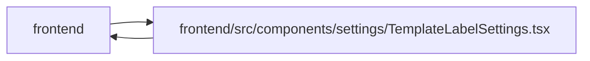

# TemplateLabelSettings Module

**Path:** `frontend/src/components/settings/TemplateLabelSettings.tsx`

## Description

_Auto-generated from `frontend/src/components/settings/TemplateLabelSettings.tsx`._

## Imports

| Source | Symbols | Type-only | Runtime emission |
|--------|---------|-----------|------------------|
| `../../features/mutationFeedback` | `MutationFeedbackMeta` | Declaration | erased |
| `../../i18n/seedDisplay` | `labelDisplay`, `labelGroupDisplay`, `templateDisplay` | — | compiler-dependent |
| `../../services/labelService` | `labelService` | — | compiler-dependent |
| `../../services/templateService` | `templateService` | — | compiler-dependent |
| `../../types/label` | `Label`, `LabelCreate`, `LabelGroup`, `LabelGroupCreate`, `LabelGroupUpdate`, `LabelUpdate` | Declaration | erased |
| `../../types/template` | `TemplateType`, `WorkTemplate`, `WorkTemplateCreate`, `WorkTemplateUpdate` | Declaration | erased |
| `../../utils/apiError` | `getApiErrorMessage` | — | compiler-dependent |
| `../common/Button` | `Button` | — | compiler-dependent |
| `../common/Input` | `Input`, `RequiredIndicator` | — | compiler-dependent |
| `../feedback/QueryState` | `QueryEmptyState`, `QueryErrorState`, `QueryLoadingState` | — | compiler-dependent |
| `../feedback/toast` | `useToast` | — | compiler-dependent |
| `../labels/LabelSelector` | `LabelSelector` | — | compiler-dependent |
| `../ui` | `OverflowMenu` | — | compiler-dependent |
| `../ui/SlideOverDrawer` | `SlideOverDrawer` | — | compiler-dependent |
| `@tanstack/react-query` | `useMutation`, `useQuery`, `useQueryClient` | — | compiler-dependent |
| `lucide-react` | `Archive`, `ChevronDown`, `ChevronUp`, `Edit3`, `FileText`, `Plus`, `Save`, `Tags`, `X` | — | compiler-dependent |
| `react` | `useId`, `useMemo`, `useRef`, `useState` | — | compiler-dependent |
| `react-i18next` | `useTranslation` | — | compiler-dependent |

## Module Signals

| Signal | Values |
|--------|--------|
| Exports | `TemplateLabelSettings` |
| Constants | `templateTypes` |

## Local dependency map

<!-- Auto-generated local dependency summary. Do not edit by hand. -->
This graph shows full source coupling. Type dependencies can be erased; compiler-dependent cycle groups are runtime candidates, not confirmed initialization cycles.

> Module-level dependencies exceed the generated-diagram limits, so the diagram and table below group them by top-level package. Counts report the number of module neighbors in each package.

### Internal neighbors

| Direction | Module |
|---|---|
| Inbound | `frontend` (2) |
| Outbound | `frontend` (14) |

### External packages

| Language | Used packages | Undeclared packages |
|---|---:|---:|
| typescript | 4 | 0 |

> All 16 module neighbor(s) are summarized by package because the module-level view exceeds the 12-node limit.

## Classes

| Class | Kind | Line | Bases / Target | Description |
|-------|------|------|----------------|-------------|
| [TemplateFormState](../entities/TemplateFormState.md) | Interface | 38 | — | — |
| [LabelGroupFormState](../entities/LabelGroupFormState.md) | Interface | 53 | — | — |
| [LabelFormState](../entities/LabelFormState.md) | Interface | 62 | — | — |
| [TemplateRowProps](../entities/TemplateRowProps.md) | Interface | 221 | — | — |
| [ManagementSection](../entities/ManagementSection.md) | Type alias | 37 | `'templates' \| 'labels'` | — |

## Functions

| Function | Signature | Decorators | Description |
|----------|-----------|------------|-------------|
| `TemplateLabelSettings` | `()` | — | — |
