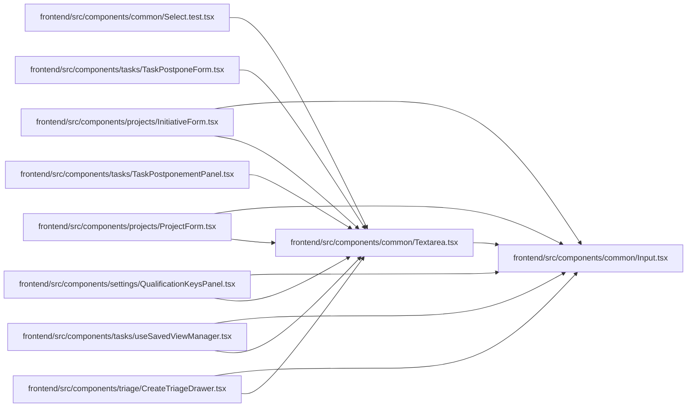

# Textarea Module

**Path:** `frontend/src/components/common/Textarea.tsx`

## Description

_Auto-generated from `frontend/src/components/common/Textarea.tsx`._

## Imports

| Source | Symbols | Type-only | Runtime emission |
|--------|---------|-----------|------------------|
| `./Input` | `RequiredIndicator` | — | compiler-dependent |
| `clsx` | `clsx` | — | compiler-dependent |
| `react` | `ReactNode`, `TextareaHTMLAttributes` | Declaration | erased |
| `react` | `forwardRef`, `useId` | — | compiler-dependent |

## Module Signals

| Signal | Values |
|--------|--------|
| Exports | `Textarea` |
| Constants | `Textarea` |
| Module calls | `Textarea = forwardRef` |

## Local dependency map

<!-- Auto-generated local dependency summary. Do not edit by hand. -->

### Internal neighbors

| Direction | Module |
|---|---|
| Inbound | [Select.test](../modules/Select.test.md) |
| Inbound | [InitiativeForm](../modules/InitiativeForm.md) |
| Inbound | [ProjectForm](../modules/ProjectForm.md) |
| Inbound | [QualificationKeysPanel](../modules/QualificationKeysPanel.md) |
| Inbound | [TaskPostponeForm](../modules/TaskPostponeForm.md) |
| Inbound | [TaskPostponementPanel](../modules/TaskPostponementPanel.md) |
| Inbound | [useSavedViewManager](../modules/useSavedViewManager.md) |
| Inbound | [CreateTriageDrawer](../modules/CreateTriageDrawer.md) |
| Outbound | [Input](../modules/Input.md) |

### External packages

| Language | Used packages | Undeclared packages |
|---|---:|---:|
| typescript | 2 | 0 |

## Classes

| Class | Kind | Line | Bases / Target | Description |
|-------|------|------|----------------|-------------|
| [TextareaProps](../entities/TextareaProps.md) | Interface | 6 | `TextareaHTMLAttributes<HTMLTextAreaElement>` | — |
