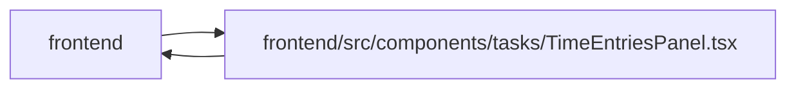

# TimeEntriesPanel Module

**Path:** `frontend/src/components/tasks/TimeEntriesPanel.tsx`

## Description

_Auto-generated from `frontend/src/components/tasks/TimeEntriesPanel.tsx`._

The optional task/project disclosure retains scoped personal drafts and creation UUIDs across failures. Both embedded and disclosure forms remount when principal, project, task or caller draft key changes. The same scope partitions session storage even when a caller reuses its key; date-range changes retain the current form and retry identity. Standalone keys retain the principal prefix consumed by account-switch cleanup. Unscoped legacy time drafts are not adopted because their authorship and recording scope cannot be established. Entry corrections require an explicit current-version choice after conflicts. A separate HTML form owns the auxiliary controls, so native time requirements never block the parent task form. Parent or standalone draft guards protect navigation, pending commands and sign-out; private rows/history are hidden on authority failures. Capability-disabled controls disappear, and bounded cursor metadata is validated before continuation.

## Imports

| Source | Symbols | Type-only | Runtime emission |
|--------|---------|-----------|------------------|
| `../../components/feedback/LiveWindowStatus` | `LiveWindowStatus` | — | compiler-dependent |
| `../../features/timeEntries/useTimeEntries` | `useTimeEntries` | — | compiler-dependent |
| `../../features/useLiveWindow` | `useLiveWindow` | — | compiler-dependent |
| `../../services/taskService` | `taskService` | — | compiler-dependent |
| `../../services/timeEntryService` | `TimeEntry` | Declaration | erased |
| `../../services/timeEntryService` | `timeEntryService`, `timeAccessDenied` | — | compiler-dependent |
| `../../utils/apiError` | `getApiErrorMessage` | — | compiler-dependent |
| `../../utils/formatDate` | `formatDate` | — | compiler-dependent |
| `../common/Button` | `Button` | — | compiler-dependent |
| `../common/CollapsibleSection` | `CollapsibleSection` | — | compiler-dependent |
| `../common/Input` | `Input` | — | compiler-dependent |
| `../feedback/QueryState` | `QueryErrorState` | — | compiler-dependent |
| `./DraftDismissalDialog` | `DraftDismissalDialog` | — | compiler-dependent |
| `./useDraftDismissal` | `useDraftDismissal`, `useActiveMount` | — | compiler-dependent |
| `@tanstack/react-query` | `useInfiniteQuery`, `useMutation`, `useQuery`, `useQueryClient` | — | compiler-dependent |
| `date-fns` | `format` | — | compiler-dependent |
| `react` | `KeyboardEvent` | Declaration | erased |
| `react` | `useCallback`, `useEffect`, `useId`, `useState` | — | compiler-dependent |
| `react-dom` | `createPortal` | — | compiler-dependent |
| `react-i18next` | `useTranslation` | — | compiler-dependent |

## Module Signals

| Signal | Values |
|--------|--------|
| Exports | `TimeEntriesPanel` |

## Local dependency map

<!-- Auto-generated local dependency summary. Do not edit by hand. -->
This graph shows full source coupling. Type dependencies can be erased; compiler-dependent cycle groups are runtime candidates, not confirmed initialization cycles.

> Module-level dependencies exceed the generated-diagram limits, so the diagram and table below group them by top-level package. Counts report the number of module neighbors in each package.

### Internal neighbors

| Direction | Module |
|---|---|
| Inbound | `frontend` (4) |
| Outbound | `frontend` (13) |

### External packages

| Language | Used packages | Undeclared packages |
|---|---:|---:|
| typescript | 5 | 0 |

> All 17 module neighbor(s) are summarized by package because the module-level view exceeds the 12-node limit.

## Classes

| Class | Kind | Line | Bases / Target | Description |
|-------|------|------|----------------|-------------|
| [Draft](../entities/Draft.md) | Type alias | 22 | <pre><code>&#123; work&#95;date&#58; string&#59; timezone&#58; string&#59; minutes&#58; string&#59; note&#58; string&#59; reason&#58; string&#59;&#10;    task&#58; string&#59; request&#58; string&#59; editing&#63;&#58; Pick&#60;TimeEntry&#44; &#39;id&#39; &#124; &#39;version&#39;&#62; &#125;</code></pre> | — |

## Functions

| Function | Signature | Decorators | Description |
|----------|-----------|------------|-------------|
| `TimeEntriesPanel` | <pre><code>&#40;props&#58; &#123; projectId&#58; number&#59; taskId&#63;&#58; number&#59; disabled&#63;&#58; boolean&#59;&#10;    start&#63;&#58; string&#59; end&#63;&#58; string&#59; embedded&#63;&#58; boolean&#59; draftKey&#63;&#58; string &#124; null&#59; onDirty&#63;&#58; &#40;dirty&#58; boolean&#41; &#61;&#62; void&#59; onPending&#63;&#58; &#40;pending&#58; boolean&#41; &#61;&#62; void &#125;&#41;</code></pre> | — | — |