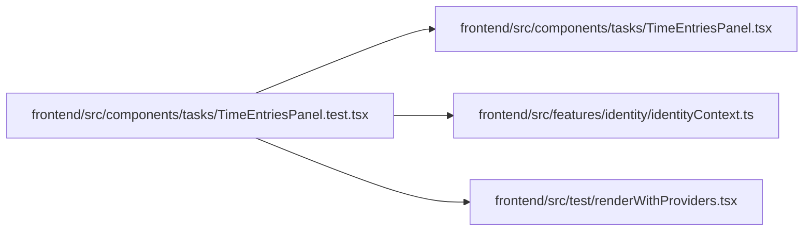

# TimeEntriesPanel.test Module

**Path:** `frontend/src/components/tasks/TimeEntriesPanel.test.tsx`

## Description

_Auto-generated from `frontend/src/components/tasks/TimeEntriesPanel.test.tsx`._

## Imports

| Source | Symbols | Type-only | Runtime emission |
|--------|---------|-----------|------------------|
| `../../features/identity/identityContext` | `IdentityContext` | — | compiler-dependent |
| `../../test/renderWithProviders` | `renderWithProviders` | — | compiler-dependent |
| `./TimeEntriesPanel` | `TimeEntriesPanel` | — | compiler-dependent |
| `@testing-library/react` | `screen`, `waitFor` | — | compiler-dependent |
| `vitest` | `beforeEach`, `expect`, `it`, `vi` | — | compiler-dependent |

## Module Signals

| Signal | Values |
|--------|--------|
| Constants | `service` |
| Module calls | `service = hoisted`, `mock`, `beforeEach`, `it`, `it`, `it`, `it`, `it`, `it.each([true, false])`, `it` |

## Local dependency map

<!-- Auto-generated local dependency summary. Do not edit by hand. -->

### Internal neighbors

| Direction | Module |
|---|---|
| Outbound | [TimeEntriesPanel](../modules/TimeEntriesPanel.md) |
| Outbound | [identityContext](../modules/identityContext.md) |
| Outbound | [renderWithProviders](../modules/renderWithProviders.md) |

### External packages

| Language | Used packages | Undeclared packages |
|---|---:|---:|
| typescript | 2 | 0 |
