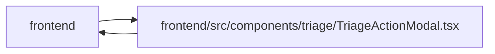

# TriageActionModal Module

**Path:** `frontend/src/components/triage/TriageActionModal.tsx`

## Description

_Auto-generated from `frontend/src/components/triage/TriageActionModal.tsx`._

## Imports

| Source | Symbols | Type-only | Runtime emission |
|--------|---------|-----------|------------------|
| `../../services/taskService` | `taskService` | — | compiler-dependent |
| `../../types/iteration` | `Iteration` | Declaration | erased |
| `../../types/triage` | `TriageActionRequest`, `TriageDuplicateRequest`, `TriageItem`, `TriageSnoozeRequest` | Declaration | erased |
| `../common/Button` | `Button` | — | compiler-dependent |
| `../common/Input` | `Input`, `RequiredIndicator` | — | compiler-dependent |
| `../common/Modal` | `Modal` | — | compiler-dependent |
| `../common/Select` | `Select` | — | compiler-dependent |
| `../feedback/QueryState` | `QueryErrorState` | — | compiler-dependent |
| `../ui/ViewSwitch` | `ViewSwitch` | — | compiler-dependent |
| `./StatusPill` | `StatusPill` | — | compiler-dependent |
| `./triageUtils` | `DuplicateActionDefaults`, `TriageLifecycleAction` | Specifier | compiler-dependent |
| `./triageUtils` | `flattenTasks`, `optionalText`, `t` | — | compiler-dependent |
| `@tanstack/react-query` | `useQuery` | — | compiler-dependent |
| `lucide-react` | `AlertCircle` | — | compiler-dependent |
| `react` | `FormEvent` | Declaration | erased |
| `react` | `useMemo`, `useState` | — | compiler-dependent |

## Module Signals

| Signal | Values |
|--------|--------|
| Exports | `TriageActionModal` |

## Local dependency map

<!-- Auto-generated local dependency summary. Do not edit by hand. -->
This graph shows full source coupling. Type dependencies can be erased; compiler-dependent cycle groups are runtime candidates, not confirmed initialization cycles.

> Module-level dependencies exceed the generated-diagram limits, so the diagram and table below group them by top-level package. Counts report the number of module neighbors in each package.

### Internal neighbors

| Direction | Module |
|---|---|
| Inbound | `frontend` (2) |
| Outbound | `frontend` (11) |

### External packages

| Language | Used packages | Undeclared packages |
|---|---:|---:|
| typescript | 3 | 0 |

> All 13 module neighbor(s) are summarized by package because the module-level view exceeds the 12-node limit.

## Classes

| Class | Kind | Line | Bases / Target | Description |
|-------|------|------|----------------|-------------|
| [TriageActionModalProps](../entities/TriageActionModalProps.md) | Interface | 24 | — | — |

## Functions

| Function | Signature | Decorators | Description |
|----------|-----------|------------|-------------|
| `TriageActionModal` | <pre><code>&#40;&#123;&#10;    action&#44;&#10;    item&#44;&#10;    allTriageItems&#44;&#10;    iterations&#44;&#10;    selectedIterationId&#44;&#10;    defaultSnooze&#44;&#10;    defaultDuplicate&#44;&#10;    isSubmitting&#44;&#10;    error&#44;&#10;    onSubmit&#44;&#10;    onClose&#44;&#10;&#125;&#58; TriageActionModalProps&#41;</code></pre> | — | — |
