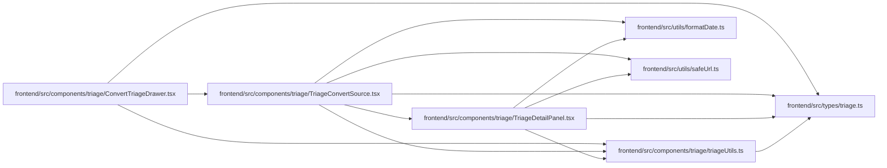

# TriageConvertSource Module

**Path:** `frontend/src/components/triage/TriageConvertSource.tsx`

## Description

_Auto-generated from `frontend/src/components/triage/TriageConvertSource.tsx`._

## Imports

| Source | Symbols | Type-only | Runtime emission |
|--------|---------|-----------|------------------|
| `../../types/triage` | `TriageItem` | Declaration | erased |
| `../../utils/formatDate` | `formatDateTime` | — | compiler-dependent |
| `../../utils/safeUrl` | `sourceLinkHref` | — | compiler-dependent |
| `./TriageDetailPanel` | `InfoBlock` | — | compiler-dependent |
| `./triageUtils` | `t` | — | compiler-dependent |
| `lucide-react` | `ExternalLink` | — | compiler-dependent |

## Module Signals

| Signal | Values |
|--------|--------|
| Exports | `TriageConvertSource` |

## Local dependency map

<!-- Auto-generated local dependency summary. Do not edit by hand. -->
This graph shows full source coupling. Type dependencies can be erased; compiler-dependent cycle groups are runtime candidates, not confirmed initialization cycles.

### Internal neighbors

| Direction | Module |
|---|---|
| Inbound | [ConvertTriageDrawer](../modules/ConvertTriageDrawer.md) |
| Outbound | [TriageDetailPanel](../modules/TriageDetailPanel.md) |
| Outbound | [triageUtils](../modules/triageUtils.md) |
| Outbound | [types_triage](../modules/types_triage.md) |
| Outbound | [formatDate](../modules/formatDate.md) |
| Outbound | [safeUrl](../modules/safeUrl.md) |

### External packages

| Language | Used packages | Undeclared packages |
|---|---:|---:|
| typescript | 1 | 0 |

## Functions

| Function | Signature | Decorators | Description |
|----------|-----------|------------|-------------|
| `TriageConvertSource` | `({ item, projectsById, iterationsById }: { item: TriageItem; projectsById: Record<number, string>; iterationsById: Record<number, string> })` | — | — |
