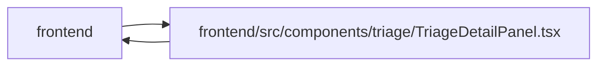

# TriageDetailPanel Module

**Path:** `frontend/src/components/triage/TriageDetailPanel.tsx`

## Description

_Auto-generated from `frontend/src/components/triage/TriageDetailPanel.tsx`._

## Imports

| Source | Symbols | Type-only | Runtime emission |
|--------|---------|-----------|------------------|
| `../../services/triageService` | `triageService` | — | compiler-dependent |
| `../../types/triage` | `TriageDuplicateSuggestion`, `TriageItem` | Declaration | erased |
| `../../utils/apiError` | `getApiErrorMessage` | — | compiler-dependent |
| `../../utils/formatDate` | `formatDateTime` | — | compiler-dependent |
| `../../utils/safeUrl` | `sourceLinkHref` | — | compiler-dependent |
| `../common/Button` | `Button` | — | compiler-dependent |
| `../requestSources/RequestSourceLinksPanel` | `RequestSourceLinksPanel` | — | compiler-dependent |
| `../ui` | `OverflowMenu` | — | compiler-dependent |
| `./StatusPill` | `StatusPill` | — | compiler-dependent |
| `./TriageSuggestions` | `ClassificationPanel`, `DuplicateSuggestionsPanel` | — | compiler-dependent |
| `./triageUtils` | `TriageLifecycleAction` | Specifier | compiler-dependent |
| `./triageUtils` | `t` | — | compiler-dependent |
| `@tanstack/react-query` | `useMutation`, `useQuery`, `useQueryClient` | — | compiler-dependent |
| `lucide-react` | `CheckCircle2`, `Clock3`, `CopyCheck`, `ExternalLink`, `Inbox`, `MessageCircleQuestion`, `Send`, `XCircle` | — | compiler-dependent |

## Module Signals

| Signal | Values |
|--------|--------|
| Exports | `InfoBlock`, `TriageDetailPanel` |

## Local dependency map

<!-- Auto-generated local dependency summary. Do not edit by hand. -->
This graph shows full source coupling. Type dependencies can be erased; compiler-dependent cycle groups are runtime candidates, not confirmed initialization cycles.

> Module-level dependencies exceed the generated-diagram limits, so the diagram and table below group them by top-level package. Counts report the number of module neighbors in each package.

### Internal neighbors

| Direction | Module |
|---|---|
| Inbound | `frontend` (2) |
| Outbound | `frontend` (11) |

### External packages

| Language | Used packages | Undeclared packages |
|---|---:|---:|
| typescript | 2 | 0 |

> All 13 module neighbor(s) are summarized by package because the module-level view exceeds the 12-node limit.

## Classes

| Class | Kind | Line | Bases / Target | Description |
|-------|------|------|----------------|-------------|
| [TriageDetailPanelProps](../entities/TriageDetailPanelProps.md) | Interface | 27 | — | — |

## Functions

| Function | Signature | Decorators | Description |
|----------|-----------|------------|-------------|
| `TriageDetailPanel` | <pre><code>&#40;&#123;&#10;    item&#44;&#10;    projectsById&#44;&#10;    iterationsById&#44;&#10;    canConvert&#44;&#10;    onAction&#44;&#10;    onMarkSuggestion&#44;&#10;    onConvert&#44;&#10;    onRequestLinksChanged&#44;&#10;&#125;&#58; TriageDetailPanelProps&#41;</code></pre> | — | — |
| `InfoBlock` | `({ label, value }: { label: string; value: string })` | — | — |
