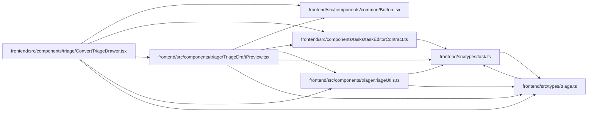

# TriageDraftPreview Module

**Path:** `frontend/src/components/triage/TriageDraftPreview.tsx`

## Description

_Auto-generated from `frontend/src/components/triage/TriageDraftPreview.tsx`._

## Imports

| Source | Symbols | Type-only | Runtime emission |
|--------|---------|-----------|------------------|
| `../../types/task` | `TaskBrief` | Declaration | erased |
| `../../types/triage` | `TriageTaskDraftResponse` | Declaration | erased |
| `../common/Button` | `Button` | — | compiler-dependent |
| `../tasks/taskEditorContract` | `newCriterion` | — | compiler-dependent |
| `./triageUtils` | `t` | — | compiler-dependent |
| `lucide-react` | `AlertCircle`, `Plus` | — | compiler-dependent |
| `react` | `Dispatch`, `SetStateAction` | Declaration | erased |

## Module Signals

| Signal | Values |
|--------|--------|
| Exports | `TriageDraftPreview` |

## Local dependency map

<!-- Auto-generated local dependency summary. Do not edit by hand. -->
This graph shows full source coupling. Type dependencies can be erased; compiler-dependent cycle groups are runtime candidates, not confirmed initialization cycles.

### Internal neighbors

| Direction | Module |
|---|---|
| Inbound | [ConvertTriageDrawer](../modules/ConvertTriageDrawer.md) |
| Outbound | [Button](../modules/Button.md) |
| Outbound | [taskEditorContract](../modules/taskEditorContract.md) |
| Outbound | [triageUtils](../modules/triageUtils.md) |
| Outbound | [types_task](../modules/types_task.md) |
| Outbound | [types_triage](../modules/types_triage.md) |

### External packages

| Language | Used packages | Undeclared packages |
|---|---:|---:|
| typescript | 2 | 0 |

## Functions

| Function | Signature | Decorators | Description |
|----------|-----------|------------|-------------|
| `TriageDraftPreview` | <pre><code>&#40;&#123; draftPreview&#44; applyDraft&#44; setBrief&#44; description&#44; setDescription&#44; title&#44; setTitle&#44; draftErrorMessage &#125;&#58; &#123;&#10;    draftPreview&#58; TriageTaskDraftResponse &#124; null&#59; applyDraft&#58; &#40;&#41; &#61;&#62; void&#59; setBrief&#58; Dispatch&#60;SetStateAction&#60;TaskBrief&#62;&#62;&#59;&#10;    description&#58; string&#59; setDescription&#58; &#40;value&#58; string &#124; &#40;&#40;previous&#58; string&#41; &#61;&#62; string&#41;&#41; &#61;&#62; void&#59;&#10;    title&#58; string&#59; setTitle&#58; &#40;value&#58; string&#41; &#61;&#62; void&#59; draftErrorMessage&#58; string &#124; null&#59;&#10;&#125;&#41;</code></pre> | — | — |
