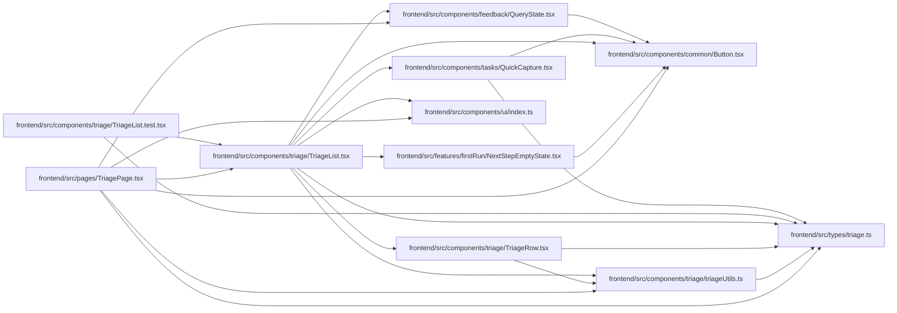

# TriageList Module

**Path:** `frontend/src/components/triage/TriageList.tsx`

## Description

_Auto-generated from `frontend/src/components/triage/TriageList.tsx`._

## Imports

| Source | Symbols | Type-only | Runtime emission |
|--------|---------|-----------|------------------|
| `../../features/firstRun/NextStepEmptyState` | `NextStepEmptyState` | — | compiler-dependent |
| `../../types/triage` | `TriageItem` | Declaration | erased |
| `../common/Button` | `Button` | — | compiler-dependent |
| `../feedback/QueryState` | `QueryErrorState` | — | compiler-dependent |
| `../tasks/QuickCapture` | `QuickCapture` | — | compiler-dependent |
| `../ui` | `InlineEmptyState` | — | compiler-dependent |
| `./TriageRow` | `TriageRow` | — | compiler-dependent |
| `./triageUtils` | `t` | — | compiler-dependent |
| `lucide-react` | `Inbox` | — | compiler-dependent |

## Module Signals

| Signal | Values |
|--------|--------|
| Exports | `TriageList` |

## Local dependency map

<!-- Auto-generated local dependency summary. Do not edit by hand. -->
This graph shows full source coupling. Type dependencies can be erased; compiler-dependent cycle groups are runtime candidates, not confirmed initialization cycles.

### Internal neighbors

| Direction | Module |
|---|---|
| Inbound | [TriageList.test](../modules/TriageList.test.md) |
| Inbound | [TriagePage](../modules/TriagePage.md) |
| Outbound | [Button](../modules/Button.md) |
| Outbound | [QueryState](../modules/QueryState.md) |
| Outbound | [QuickCapture](../modules/QuickCapture.md) |
| Outbound | [TriageRow](../modules/TriageRow.md) |
| Outbound | [triageUtils](../modules/triageUtils.md) |
| Outbound | [index](../modules/index.md) |
| Outbound | [NextStepEmptyState](../modules/NextStepEmptyState.md) |
| Outbound | [types_triage](../modules/types_triage.md) |

### External packages

| Language | Used packages | Undeclared packages |
|---|---:|---:|
| typescript | 1 | 0 |

## Functions

| Function | Signature | Decorators | Description |
|----------|-----------|------------|-------------|
| `TriageList` | <pre><code>&#40;&#123; items&#44; selectedId&#44; projectsById&#44; iterationsById&#44; listErrorMessage&#44; isLoading&#44; activeFilterCount&#44; onRetry&#44; onSelect&#44; onCreate&#44; onReset &#125;&#58; &#123;&#10;    items&#58; TriageItem&#91;&#93;&#59; selectedId&#58; number &#124; null&#59; projectsById&#58; Record&#60;number&#44; string&#62;&#59; iterationsById&#58; Record&#60;number&#44; string&#62;&#59;&#10;    listErrorMessage&#58; string &#124; null&#59; isLoading&#58; boolean&#59; activeFilterCount&#58; number&#59; onRetry&#58; &#40;&#41; &#61;&#62; void&#59;&#10;    onSelect&#58; &#40;id&#58; number&#41; &#61;&#62; void&#59; onCreate&#58; &#40;title&#63;&#58; string&#41; &#61;&#62; void&#59; onReset&#58; &#40;&#41; &#61;&#62; void&#59;&#10;&#125;&#41;</code></pre> | — | — |
