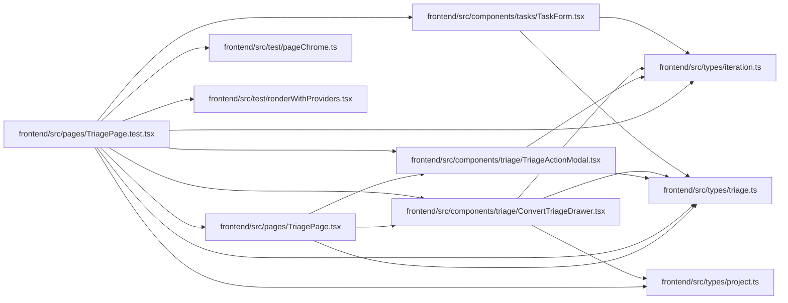

# TriagePage.test Module

**Path:** `frontend/src/pages/TriagePage.test.tsx`

## Description

_Auto-generated from `frontend/src/pages/TriagePage.test.tsx`._

## Imports

| Source | Symbols | Type-only | Runtime emission |
|--------|---------|-----------|------------------|
| `../components/tasks/TaskForm` | `TaskForm` | — | compiler-dependent |
| `../components/triage/ConvertTriageDrawer` | `ConvertTriageDrawer` | — | compiler-dependent |
| `../components/triage/TriageActionModal` | `TriageActionModal` | — | compiler-dependent |
| `../test/pageChrome` | `expectPageChrome` | — | compiler-dependent |
| `../test/renderWithProviders` | `renderWithProviders` | — | compiler-dependent |
| `../types/iteration` | `Iteration` | Declaration | erased |
| `../types/project` | `Project` | Declaration | erased |
| `../types/triage` | `TriageItem` | Declaration | erased |
| `./TriagePage` | `TriagePage` | — | compiler-dependent |
| `@testing-library/react` | `screen`, `waitFor`, `within` | — | compiler-dependent |
| `node:fs` | `readdirSync`, `readFileSync` | — | compiler-dependent |
| `node:path` | `resolve` | — | compiler-dependent |
| `vitest` | `beforeEach`, `describe`, `expect`, `it`, `vi` | — | compiler-dependent |

## Module Signals

| Signal | Values |
|--------|--------|
| Constants | `api`, `project`, `iteration`, `item`, `secondItem` |
| Module calls | `api = hoisted`, `mock`, `beforeEach`, `describe`, `describe`, `describe` |

## Local dependency map

<!-- Auto-generated local dependency summary. Do not edit by hand. -->
This graph shows full source coupling. Type dependencies can be erased; compiler-dependent cycle groups are runtime candidates, not confirmed initialization cycles.

### Internal neighbors

| Direction | Module |
|---|---|
| Outbound | [TaskForm](../modules/TaskForm.md) |
| Outbound | [ConvertTriageDrawer](../modules/ConvertTriageDrawer.md) |
| Outbound | [TriageActionModal](../modules/TriageActionModal.md) |
| Outbound | [TriagePage](../modules/TriagePage.md) |
| Outbound | [pageChrome](../modules/pageChrome.md) |
| Outbound | [renderWithProviders](../modules/renderWithProviders.md) |
| Outbound | [types_iteration](../modules/types_iteration.md) |
| Outbound | [types_project](../modules/types_project.md) |
| Outbound | [types_triage](../modules/types_triage.md) |

### External packages

| Language | Used packages | Undeclared packages |
|---|---:|---:|
| typescript | 2 | 0 |
