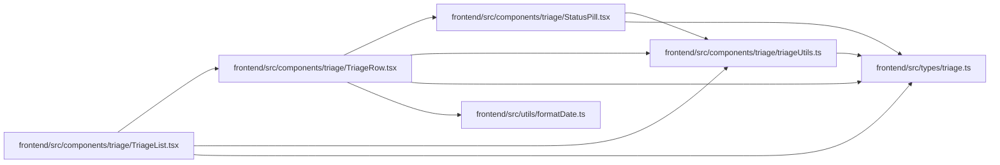

# TriageRow Module

**Path:** `frontend/src/components/triage/TriageRow.tsx`

## Description

_Auto-generated from `frontend/src/components/triage/TriageRow.tsx`._

## Imports

| Source | Symbols | Type-only | Runtime emission |
|--------|---------|-----------|------------------|
| `../../types/triage` | `TriageItem` | Declaration | erased |
| `../../utils/formatDate` | `formatDateTime` | — | compiler-dependent |
| `./StatusPill` | `StatusPill` | — | compiler-dependent |
| `./triageUtils` | `isDueSnoozed`, `t` | — | compiler-dependent |
| `clsx` | `clsx` | — | compiler-dependent |
| `lucide-react` | `MessageSquare` | — | compiler-dependent |

## Module Signals

| Signal | Values |
|--------|--------|
| Exports | `TriageRow` |

## Local dependency map

<!-- Auto-generated local dependency summary. Do not edit by hand. -->
This graph shows full source coupling. Type dependencies can be erased; compiler-dependent cycle groups are runtime candidates, not confirmed initialization cycles.

### Internal neighbors

| Direction | Module |
|---|---|
| Inbound | [TriageList](../modules/TriageList.md) |
| Outbound | [StatusPill](../modules/StatusPill.md) |
| Outbound | [triageUtils](../modules/triageUtils.md) |
| Outbound | [types_triage](../modules/types_triage.md) |
| Outbound | [formatDate](../modules/formatDate.md) |

### External packages

| Language | Used packages | Undeclared packages |
|---|---:|---:|
| typescript | 2 | 0 |

## Classes

| Class | Kind | Line | Bases / Target | Description |
|-------|------|------|----------------|-------------|
| [TriageRowProps](../entities/TriageRowProps.md) | Interface | 12 | — | — |

## Functions

| Function | Signature | Decorators | Description |
|----------|-----------|------------|-------------|
| `TriageRow` | <pre><code>&#40;&#123;&#10;    item&#44;&#10;    isSelected&#44;&#10;    projectsById&#44;&#10;    iterationsById&#44;&#10;    onSelect&#44;&#10;&#125;&#58; TriageRowProps&#41;</code></pre> | — | — |
