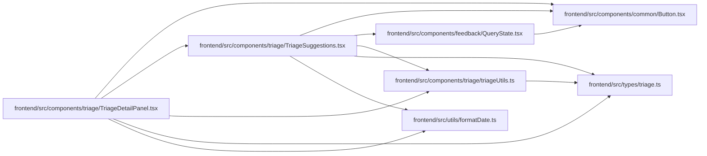

# TriageSuggestions Module

**Path:** `frontend/src/components/triage/TriageSuggestions.tsx`

## Description

_Auto-generated from `frontend/src/components/triage/TriageSuggestions.tsx`._

## Imports

| Source | Symbols | Type-only | Runtime emission |
|--------|---------|-----------|------------------|
| `../../types/triage` | `TriageClassificationSuggestion`, `TriageDuplicateSuggestion`, `TriageDuplicateSuggestionsResponse` | Declaration | erased |
| `../../utils/formatDate` | `formatDateTime` | — | compiler-dependent |
| `../common/Button` | `Button` | — | compiler-dependent |
| `../feedback/QueryState` | `QueryErrorState` | — | compiler-dependent |
| `./triageUtils` | `formatSuggestionScore`, `t` | — | compiler-dependent |
| `lucide-react` | `CopyCheck`, `Loader2`, `Sparkles` | — | compiler-dependent |

## Module Signals

| Signal | Values |
|--------|--------|
| Exports | `ClassificationPanel`, `DuplicateSuggestionsPanel` |

## Local dependency map

<!-- Auto-generated local dependency summary. Do not edit by hand. -->
This graph shows full source coupling. Type dependencies can be erased; compiler-dependent cycle groups are runtime candidates, not confirmed initialization cycles.

### Internal neighbors

| Direction | Module |
|---|---|
| Inbound | [TriageDetailPanel](../modules/TriageDetailPanel.md) |
| Outbound | [Button](../modules/Button.md) |
| Outbound | [QueryState](../modules/QueryState.md) |
| Outbound | [triageUtils](../modules/triageUtils.md) |
| Outbound | [types_triage](../modules/types_triage.md) |
| Outbound | [formatDate](../modules/formatDate.md) |

### External packages

| Language | Used packages | Undeclared packages |
|---|---:|---:|
| typescript | 1 | 0 |

## Classes

| Class | Kind | Line | Bases / Target | Description |
|-------|------|------|----------------|-------------|
| [DuplicateSuggestionsPanelProps](../entities/DuplicateSuggestionsPanelProps.md) | Interface | 16 | — | — |
| [DuplicateSuggestionGroupProps](../entities/DuplicateSuggestionGroupProps.md) | Interface | 80 | — | — |
| [ClassificationPanelProps](../entities/ClassificationPanelProps.md) | Interface | 140 | — | — |

## Functions

| Function | Signature | Decorators | Description |
|----------|-----------|------------|-------------|
| `DuplicateSuggestionsPanel` | <pre><code>&#40;&#123;&#10;    suggestions&#44;&#10;    isLoading&#44;&#10;    isError&#44;&#10;    error&#44;&#10;    onRetry&#44;&#10;    projectsById&#44;&#10;    iterationsById&#44;&#10;    onMarkSuggestion&#44;&#10;&#125;&#58; DuplicateSuggestionsPanelProps&#41;</code></pre> | — | — |
| `ClassificationPanel` | <pre><code>&#40;&#123;&#10;    suggestions&#44;&#10;    isLoading&#44;&#10;    isError&#44;&#10;    error&#44;&#10;    onRetry&#44;&#10;    onClassify&#44;&#10;    isClassifying&#44;&#10;    classifyError&#44;&#10;&#125;&#58; ClassificationPanelProps&#41;</code></pre> | — | — |
