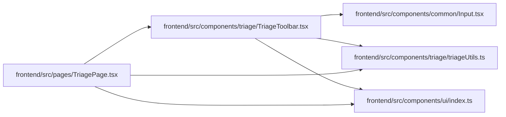

# TriageToolbar Module

**Path:** `frontend/src/components/triage/TriageToolbar.tsx`

## Description

_Auto-generated from `frontend/src/components/triage/TriageToolbar.tsx`._

## Imports

| Source | Symbols | Type-only | Runtime emission |
|--------|---------|-----------|------------------|
| `../common/Input` | `Input` | — | compiler-dependent |
| `../ui` | `FilterBar`, `PageToolbar`, `ViewSwitch` | — | compiler-dependent |
| `./triageUtils` | `AGENT_SOURCE_LABEL_KEYS`, `statusLabelKeys`, `statusOptions` | — | compiler-dependent |
| `lucide-react` | `Search` | — | compiler-dependent |
| `react-i18next` | `useTranslation` | — | compiler-dependent |

## Module Signals

| Signal | Values |
|--------|--------|
| Exports | `TriageToolbar` |

## Local dependency map

<!-- Auto-generated local dependency summary. Do not edit by hand. -->

### Internal neighbors

| Direction | Module |
|---|---|
| Inbound | [TriagePage](../modules/TriagePage.md) |
| Outbound | [Input](../modules/Input.md) |
| Outbound | [triageUtils](../modules/triageUtils.md) |
| Outbound | [index](../modules/index.md) |

### External packages

| Language | Used packages | Undeclared packages |
|---|---:|---:|
| typescript | 2 | 0 |

## Functions

| Function | Signature | Decorators | Description |
|----------|-----------|------------|-------------|
| `TriageToolbar` | <pre><code>&#40;&#123; search&#44; source&#44; status&#44; label&#44; activeOnly&#44; sources&#44; labels&#44; onSearch&#44; onFilter&#44; onView&#44; onClear &#125;&#58; &#123;&#10;    search&#58; string&#59; source&#58; string&#59; status&#58; string&#59; label&#58; string&#59; activeOnly&#58; boolean&#59; sources&#58; string&#91;&#93;&#59; labels&#58; string&#91;&#93;&#59;&#10;    onSearch&#58; &#40;value&#58; string&#41; &#61;&#62; void&#59; onFilter&#58; &#40;id&#58; string&#44; value&#58; string&#41; &#61;&#62; void&#59;&#10;    onView&#58; &#40;activeOnly&#58; boolean&#41; &#61;&#62; void&#59; onClear&#58; &#40;&#41; &#61;&#62; void&#59;&#10;&#125;&#41;</code></pre> | — | — |
