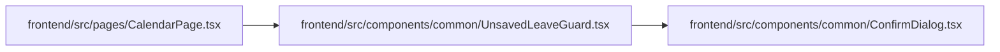

# UnsavedLeaveGuard Module

**Path:** `frontend/src/components/common/UnsavedLeaveGuard.tsx`

## Description

_Auto-generated from `frontend/src/components/common/UnsavedLeaveGuard.tsx`._

## Imports

| Source | Symbols | Type-only | Runtime emission |
|--------|---------|-----------|------------------|
| `./ConfirmDialog` | `ConfirmDialog` | — | compiler-dependent |
| `react` | `useContext`, `useEffect` | — | compiler-dependent |
| `react-router-dom` | `UNSAFE_DataRouterContext`, `useBlocker` | — | compiler-dependent |

## Module Signals

| Signal | Values |
|--------|--------|
| Exports | `UnsavedLeaveGuard` |

## Local dependency map

<!-- Auto-generated local dependency summary. Do not edit by hand. -->

### Internal neighbors

| Direction | Module |
|---|---|
| Inbound | [CalendarPage](../modules/CalendarPage.md) |
| Outbound | [ConfirmDialog](../modules/ConfirmDialog.md) |

### External packages

| Language | Used packages | Undeclared packages |
|---|---:|---:|
| typescript | 2 | 0 |

## Classes

| Class | Kind | Line | Bases / Target | Description |
|-------|------|------|----------------|-------------|
| [UnsavedLeaveGuardProps](../entities/UnsavedLeaveGuardProps.md) | Interface | 5 | — | — |

## Functions

| Function | Signature | Decorators | Description |
|----------|-----------|------------|-------------|
| `UnsavedLeaveGuard` | `(props: UnsavedLeaveGuardProps)` | — | Asks before leaving a page with unsaved changes, in the app and on reload or close. |
