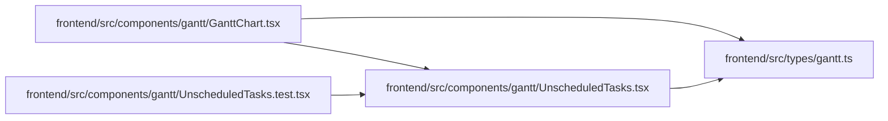

# UnscheduledTasks Module

**Path:** `frontend/src/components/gantt/UnscheduledTasks.tsx`

## Description

_Auto-generated from `frontend/src/components/gantt/UnscheduledTasks.tsx`._

## Imports

| Source | Symbols | Type-only | Runtime emission |
|--------|---------|-----------|------------------|
| `../../types/gantt` | `UnscheduledTask` | Declaration | erased |
| `react-i18next` | `useTranslation` | — | compiler-dependent |

## Module Signals

| Signal | Values |
|--------|--------|
| Exports | `UnscheduledTasks` |

## Local dependency map

<!-- Auto-generated local dependency summary. Do not edit by hand. -->
This graph shows full source coupling. Type dependencies can be erased; compiler-dependent cycle groups are runtime candidates, not confirmed initialization cycles.

### Internal neighbors

| Direction | Module |
|---|---|
| Inbound | [GanttChart](../modules/GanttChart.md) |
| Inbound | [UnscheduledTasks.test](../modules/UnscheduledTasks.test.md) |
| Outbound | [types_gantt](../modules/types_gantt.md) |

### External packages

| Language | Used packages | Undeclared packages |
|---|---:|---:|
| typescript | 1 | 0 |

## Functions

| Function | Signature | Decorators | Description |
|----------|-----------|------------|-------------|
| `UnscheduledTasks` | `({ items }: { items?: UnscheduledTask[] })` | — | The planned tasks a schedule run leaves without dates, each with what would get it scheduled. |
