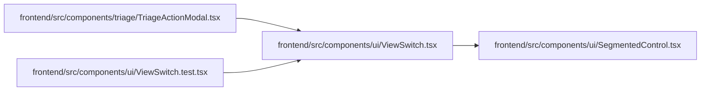

# ViewSwitch Module

**Path:** `frontend/src/components/ui/ViewSwitch.tsx`

## Description

_Auto-generated from `frontend/src/components/ui/ViewSwitch.tsx`._

## Imports

| Source | Symbols | Type-only | Runtime emission |
|--------|---------|-----------|------------------|
| `./SegmentedControl` | `SegmentedOption` | Specifier | compiler-dependent |
| `./SegmentedControl` | `SegmentedControl` | — | compiler-dependent |

## Module Signals

| Signal | Values |
|--------|--------|
| Exports | `ViewSwitch` |

## Local dependency map

<!-- Auto-generated local dependency summary. Do not edit by hand. -->
This graph shows full source coupling. Type dependencies can be erased; compiler-dependent cycle groups are runtime candidates, not confirmed initialization cycles.

### Internal neighbors

| Direction | Module |
|---|---|
| Inbound | [TriageActionModal](../modules/TriageActionModal.md) |
| Inbound | [ViewSwitch.test](../modules/ViewSwitch.test.md) |
| Outbound | [SegmentedControl](../modules/SegmentedControl.md) |

## Functions

| Function | Signature | Decorators | Description |
|----------|-----------|------------|-------------|
| `ViewSwitch` | <pre><code>&#60;T extends string&#62;&#40;&#123; label&#44; options&#44; value&#44; onChange&#44; className &#125;&#58; &#123;&#10;    label&#58; string&#59;&#10;    options&#58; SegmentedOption&#60;T&#62;&#91;&#93;&#59;&#10;    value&#58; T&#59;&#10;    onChange&#58; &#40;value&#58; T&#41; &#61;&#62; void&#59;&#10;    className&#63;&#58; string&#59;&#10;&#125;&#41;</code></pre> | — | Switches between views of the same records, such as a list and a board. |
