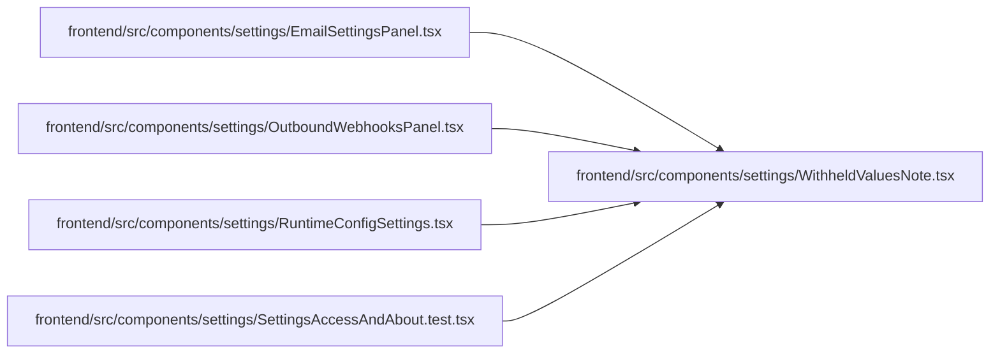

# WithheldValuesNote Module

**Path:** `frontend/src/components/settings/WithheldValuesNote.tsx`

## Description

_Auto-generated from `frontend/src/components/settings/WithheldValuesNote.tsx`._

## Imports

| Source | Symbols | Type-only | Runtime emission |
|--------|---------|-----------|------------------|
| `lucide-react` | `EyeOff` | — | compiler-dependent |
| `react-i18next` | `useTranslation` | — | compiler-dependent |

## Module Signals

| Signal | Values |
|--------|--------|
| Exports | `WithheldValuesNote` |

## Local dependency map

<!-- Auto-generated local dependency summary. Do not edit by hand. -->

### Internal neighbors

| Direction | Module |
|---|---|
| Inbound | [EmailSettingsPanel](../modules/EmailSettingsPanel.md) |
| Inbound | [OutboundWebhooksPanel](../modules/OutboundWebhooksPanel.md) |
| Inbound | [RuntimeConfigSettings](../modules/RuntimeConfigSettings.md) |
| Inbound | [SettingsAccessAndAbout.test](../modules/SettingsAccessAndAbout.test.md) |

### External packages

| Language | Used packages | Undeclared packages |
|---|---:|---:|
| typescript | 2 | 0 |

## Functions

| Function | Signature | Decorators | Description |
|----------|-----------|------------|-------------|
| `WithheldValuesNote` | `({ fields, labels }: { fields: string[] \| undefined; labels: Record<string, string> })` | — | Names the values the server left out because this browser has no admin key. |
