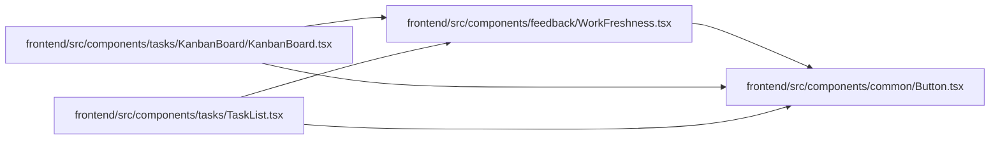

# WorkFreshness Module

**Path:** `frontend/src/components/feedback/WorkFreshness.tsx`

## Description

Displays the update time, unavailable/stale state, and refresh action for a caller-owned work query. Query scheduling and identity cache ownership live in the separate workQueryFreshness and identity modules.

## Imports

| Source | Symbols | Type-only | Runtime emission |
|--------|---------|-----------|------------------|
| `../common/Button` | `Button` | — | compiler-dependent |
| `react-i18next` | `useTranslation` | — | compiler-dependent |

## Module Signals

| Signal | Values |
|--------|--------|
| Exports | `WorkFreshness` |

## Local dependency map

<!-- Auto-generated local dependency summary. Do not edit by hand. -->

### Internal neighbors

| Direction | Module |
|---|---|
| Inbound | [KanbanBoard](../modules/KanbanBoard.md) |
| Inbound | [TaskList](../modules/TaskList.md) |
| Outbound | [Button](../modules/Button.md) |

### External packages

| Language | Used packages | Undeclared packages |
|---|---:|---:|
| typescript | 1 | 0 |

## Functions

| Function | Signature | Decorators | Description |
|----------|-----------|------------|-------------|
| `WorkFreshness` | <pre><code>&#40;&#123; stale&#44; refreshing&#44; onRefresh &#125;&#58; &#123;&#10;    stale&#58; boolean&#59; refreshing&#58; boolean&#59; onRefresh&#58; &#40;&#41; &#61;&#62; void&#59;&#10;&#125;&#41;</code></pre> | — | Recovery for a caller-owned work query: silent while its data is current (the shell |