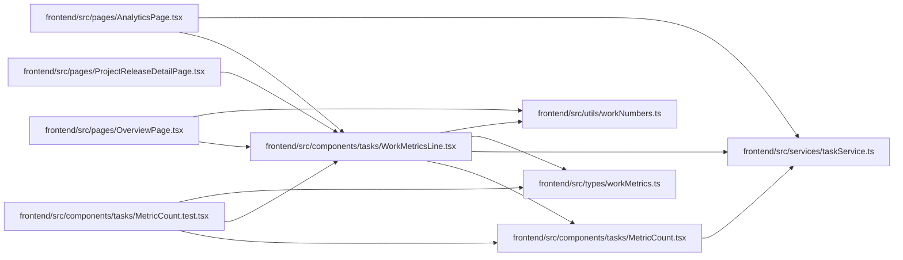

# WorkMetricsLine Module

**Path:** `frontend/src/components/tasks/WorkMetricsLine.tsx`

## Description

_Auto-generated from `frontend/src/components/tasks/WorkMetricsLine.tsx`._

## Imports

| Source | Symbols | Type-only | Runtime emission |
|--------|---------|-----------|------------------|
| `../../services/taskService` | `MetricScope`, `WorkMetricName` | Declaration | erased |
| `../../types/workMetrics` | `WorkMetrics` | Declaration | erased |
| `../../utils/workNumbers` | `formatCount` | — | compiler-dependent |
| `./MetricCount` | `MetricCount` | — | compiler-dependent |
| `react-i18next` | `useTranslation` | — | compiler-dependent |

## Module Signals

| Signal | Values |
|--------|--------|
| Exports | `WorkMetricsLine` |

## Local dependency map

<!-- Auto-generated local dependency summary. Do not edit by hand. -->
This graph shows full source coupling. Type dependencies can be erased; compiler-dependent cycle groups are runtime candidates, not confirmed initialization cycles.

### Internal neighbors

| Direction | Module |
|---|---|
| Inbound | [MetricCount.test](../modules/MetricCount.test.md) |
| Inbound | [AnalyticsPage](../modules/AnalyticsPage.md) |
| Inbound | [OverviewPage](../modules/OverviewPage.md) |
| Inbound | [ProjectReleaseDetailPage](../modules/ProjectReleaseDetailPage.md) |
| Outbound | [MetricCount](../modules/MetricCount.md) |
| Outbound | [taskService](../modules/taskService.md) |
| Outbound | [workMetrics](../modules/workMetrics.md) |
| Outbound | [workNumbers](../modules/workNumbers.md) |

### External packages

| Language | Used packages | Undeclared packages |
|---|---:|---:|
| typescript | 1 | 0 |

## Functions

| Function | Signature | Decorators | Description |
|----------|-----------|------------|-------------|
| `WorkMetricsLine` | `({ metrics, scope = null }: { metrics?: WorkMetrics \| null; scope?: MetricScope \| null })` | — | Delivery counts; with a scope, each one opens the tasks it counts. |
