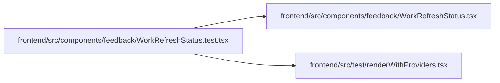

# WorkRefreshStatus.test Module

**Path:** `frontend/src/components/feedback/WorkRefreshStatus.test.tsx`

## Description

_Auto-generated from `frontend/src/components/feedback/WorkRefreshStatus.test.tsx`._

## Imports

| Source | Symbols | Type-only | Runtime emission |
|--------|---------|-----------|------------------|
| `../../test/renderWithProviders` | `renderWithProviders` | — | compiler-dependent |
| `./WorkRefreshStatus` | `WorkRefreshStatus` | — | compiler-dependent |
| `@tanstack/react-query` | `useQuery` | — | compiler-dependent |
| `@testing-library/react` | `fireEvent`, `screen` | — | compiler-dependent |
| `react` | `useState` | — | compiler-dependent |
| `vitest` | `afterEach`, `expect`, `it`, `vi` | — | compiler-dependent |

## Module Signals

| Signal | Values |
|--------|--------|
| Module calls | `afterEach`, `it` |

## Local dependency map

<!-- Auto-generated local dependency summary. Do not edit by hand. -->

### Internal neighbors

| Direction | Module |
|---|---|
| Outbound | [WorkRefreshStatus](../modules/WorkRefreshStatus.md) |
| Outbound | [renderWithProviders](../modules/renderWithProviders.md) |

### External packages

| Language | Used packages | Undeclared packages |
|---|---:|---:|
| typescript | 4 | 0 |
