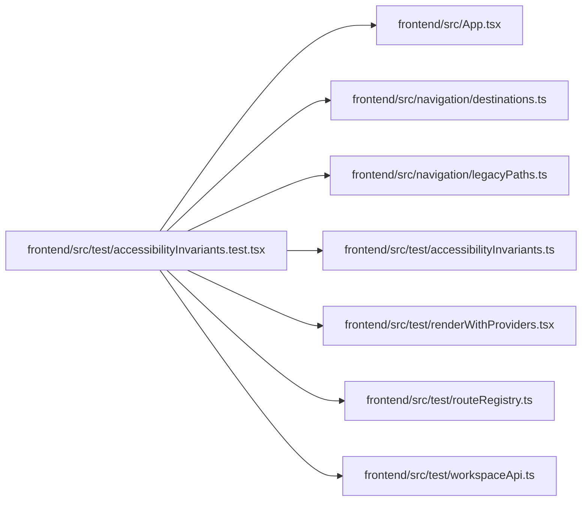

# accessibilityInvariants.test Module

**Path:** `frontend/src/test/accessibilityInvariants.test.tsx`

## Description

_Auto-generated from `frontend/src/test/accessibilityInvariants.test.tsx`._

## Imports

| Source | Symbols | Type-only | Runtime emission |
|--------|---------|-----------|------------------|
| `../App` | `App` | — | compiler-dependent |
| `../navigation/destinations` | `getDestinationForPath` | — | compiler-dependent |
| `../navigation/legacyPaths` | `mapLegacyPath` | — | compiler-dependent |
| `./accessibilityInvariants` | `accessibleNameViolations`, `headingOrderViolations`, `summaryNameViolations` | — | compiler-dependent |
| `./renderWithProviders` | `renderWithProviders` | — | compiler-dependent |
| `./routeRegistry` | `routeRegistry` | — | compiler-dependent |
| `./workspaceApi` | `installWorkspaceApi` | — | compiler-dependent |
| `@testing-library/dom` | `getRoles` | — | compiler-dependent |
| `@testing-library/react` | `act`, `waitFor` | — | compiler-dependent |
| `dom-accessibility-api` | `computeAccessibleName` | — | compiler-dependent |
| `vitest` | `afterEach`, `describe`, `expect`, `it`, `vi` | — | compiler-dependent |

## Module Signals

| Signal | Values |
|--------|--------|
| Constants | `PAGE`, `TRIAGE_ITEM`, `SHELL_AND_PAGE_READS`, `BARE_ROUTES` |
| Module calls | `afterEach`, `describe`, `BARE_ROUTES = Set`, `describe` |

## Local dependency map

<!-- Auto-generated local dependency summary. Do not edit by hand. -->

### Internal neighbors

| Direction | Module |
|---|---|
| Outbound | [App](../modules/App.md) |
| Outbound | [destinations](../modules/destinations.md) |
| Outbound | [legacyPaths](../modules/legacyPaths.md) |
| Outbound | [accessibilityInvariants](../modules/accessibilityInvariants.md) |
| Outbound | [renderWithProviders](../modules/renderWithProviders.md) |
| Outbound | [routeRegistry](../modules/routeRegistry.md) |
| Outbound | [workspaceApi](../modules/workspaceApi.md) |

### External packages

| Language | Used packages | Undeclared packages |
|---|---:|---:|
| typescript | 4 | 0 |
