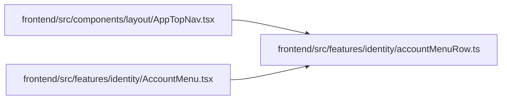

# accountMenuRow Module

**Path:** `frontend/src/features/identity/accountMenuRow.ts`

## Description

_Auto-generated from `frontend/src/features/identity/accountMenuRow.ts`._

## Imports

| Source | Symbols | Type-only | Runtime emission |
|--------|---------|-----------|------------------|
| `react` | `createContext` | — | compiler-dependent |

## Module Signals

| Signal | Values |
|--------|--------|
| Exports | `AccountMenuRowContext` |
| Constants | `AccountMenuRowContext` |
| Module calls | `AccountMenuRowContext = createContext` |

## Local dependency map

<!-- Auto-generated local dependency summary. Do not edit by hand. -->

### Internal neighbors

| Direction | Module |
|---|---|
| Inbound | [AppTopNav](../modules/AppTopNav.md) |
| Inbound | [AccountMenu](../modules/AccountMenu.md) |

### External packages

| Language | Used packages | Undeclared packages |
|---|---:|---:|
| typescript | 1 | 0 |
