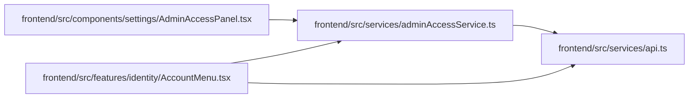

# adminAccessService Module

**Path:** `frontend/src/services/adminAccessService.ts`

## Description

_Auto-generated from `frontend/src/services/adminAccessService.ts`._

## Imports

| Source | Symbols | Type-only | Runtime emission |
|--------|---------|-----------|------------------|
| `./api` | `api` | — | compiler-dependent |

## Module Signals

| Signal | Values |
|--------|--------|
| Exports | `verifyAdminApiKey` |

## Local dependency map

<!-- Auto-generated local dependency summary. Do not edit by hand. -->

### Internal neighbors

| Direction | Module |
|---|---|
| Inbound | [AdminAccessPanel](../modules/AdminAccessPanel.md) |
| Inbound | [AccountMenu](../modules/AccountMenu.md) |
| Outbound | [api](../modules/api.md) |

## Functions

| Function | Signature | Decorators | Description |
|----------|-----------|------------|-------------|
| `verifyAdminApiKey` | *(async)* `(key: string)` | — | Check a candidate key without changing the credential stored in this tab. |
