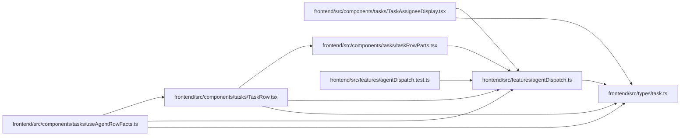

# agentDispatch Module

**Path:** `frontend/src/features/agentDispatch.ts`

## Description

_Auto-generated from `frontend/src/features/agentDispatch.ts`._

## Imports

| Source | Symbols | Type-only | Runtime emission |
|--------|---------|-----------|------------------|
| `../types/task` | `Task`, `TaskStatus` | Declaration | erased |

## Module Signals

| Signal | Values |
|--------|--------|
| Exports | `AGENT_DISPATCH_LABEL_KEY`, `AgentDispatchFacts`, `AgentDispatchState`, `agentDispatchState`, `taskAgentDispatchState` |
| Constants | `AGENT_DISPATCH_LABEL_KEY` |

## Local dependency map

<!-- Auto-generated local dependency summary. Do not edit by hand. -->
This graph shows full source coupling. Type dependencies can be erased; compiler-dependent cycle groups are runtime candidates, not confirmed initialization cycles.

### Internal neighbors

| Direction | Module |
|---|---|
| Inbound | [TaskAssigneeDisplay](../modules/TaskAssigneeDisplay.md) |
| Inbound | [TaskRow](../modules/TaskRow.md) |
| Inbound | [taskRowParts](../modules/taskRowParts.md) |
| Inbound | [useAgentRowFacts](../modules/useAgentRowFacts.md) |
| Inbound | [agentDispatch.test](../modules/agentDispatch.test.md) |
| Outbound | [types_task](../modules/types_task.md) |

## Classes

| Class | Kind | Line | Bases / Target | Description |
|-------|------|------|----------------|-------------|
| [AgentDispatchFacts](../entities/AgentDispatchFacts.md) | Interface | 9 | — | — |
| [AgentDispatchState](../entities/AgentDispatchState.md) | Type alias | 7 | `'noAgentConnected' \| 'notSentYet' \| 'queued' \| 'working' \| 'waitingForReview' \| 'unknown'` | Where an agent's work on a task stands, as one line under the agent's name. `unknown` is the |

## Functions

| Function | Signature | Decorators | Description |
|----------|-----------|------------|-------------|
| `agentDispatchState` | `({ status, liveAssignment, runBegun, agentConnected }: AgentDispatchFacts) -> AgentDispatchState \| null` | — | The dispatch state of a task given to an agent, from fields the task and team APIs return. |
| `taskAgentDispatchState` | `(task: Pick<Task, 'status' \| 'agent_working' \| 'claimed_by'>, agentConnected: boolean \| undefined) -> AgentDispatchState \| null` | — | The dispatch facts a loaded task carries; whether the agent is connected comes from the team read. |
