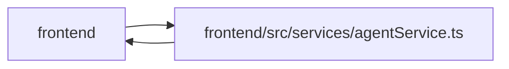

# agentService Module

**Path:** `frontend/src/services/agentService.ts`

## Description

_Auto-generated from `frontend/src/services/agentService.ts`._

## Imports

| Source | Symbols | Type-only | Runtime emission |
|--------|---------|-----------|------------------|
| `../types/agent` | `AgentActorRosterItem`, `AgentAssignmentListParams`, `AgentAssignmentReadItem`, `AgentCapabilities`, `AgentCommandMetadata`, `AgentModelBinding`, `AgentModelBindingCreate`, `AgentModelBindingDisable`, `AgentModelBindingListParams`, `AgentModelBindingUpdate`, `AgentModelCatalogCreate`, `AgentModelCatalogDisable`, `AgentModelCatalogEntry`, `AgentModelCatalogUpdate`, `AgentModelMutationReceipt`, `AgentPipeline`, `AgentProfileSkillCatalogItem`, `AgentRoutingPreviewCreate`, `AgentRoutingPreviewResponse`, `AgentRun`, `AgentTaskAssignment`, `AgentTeamApplyResponse`, `AgentTeamMaster`, `AgentTeamPlan`, `AgentTeamStatus`, `AgentTeamValidation`, `ModelAwareAgentTaskAssignmentCreate`, `ModelAwareAgentTaskAssignmentUpdate`, `RoutingQualificationKey`, `RoutingQualificationKeyDeclare`, `RoutingQualificationKeyDetail`, `RoutingQualificationKeyRegistry`, `RoutingQualificationKeyRevise`, `TaskRoutingAssessmentCommand`, `TaskRoutingAssessmentHistory`, `TaskRoutingAssessmentMutationReceipt`, `TaskRoutingAssessmentState`, `TaskTimelineResponse` | Declaration | erased |
| `./api` | `api` | — | compiler-dependent |

## Module Signals

| Signal | Values |
|--------|--------|
| Exports | `agentService` |
| Constants | `agentService` |

## Local dependency map

<!-- Auto-generated local dependency summary. Do not edit by hand. -->
This graph shows full source coupling. Type dependencies can be erased; compiler-dependent cycle groups are runtime candidates, not confirmed initialization cycles.

> Module-level dependencies exceed the generated-diagram limits, so the diagram and table below group them by top-level package. Counts report the number of module neighbors in each package.

### Internal neighbors

| Direction | Module |
|---|---|
| Inbound | `frontend` (16) |
| Outbound | `frontend` (2) |

> All 18 module neighbor(s) are summarized by package because the module-level view exceeds the 12-node limit.
