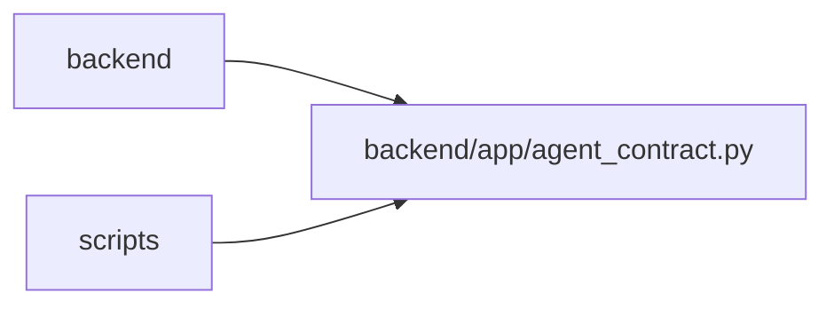

# agent_contract Module

**Path:** `backend/app/agent_contract.py`

## Description

The shared capability handshake advertises `canonical-task-brief-v1` for typed worker context, criterion-bound submission and independent acceptance. The feature projection remains identical for REST and MCP.

Shared capability handshake contract for REST and MCP projections.

## Imports

| Source | Symbols |
|--------|---------|
| `__future__` | `annotations` |

## Local dependency map

<!-- Auto-generated local dependency summary. Do not edit by hand. -->

> Module-level dependencies exceed the generated-diagram limits, so the diagram and table below group them by top-level package. Counts report the number of module neighbors in each package.

### Internal neighbors

| Direction | Module |
|---|---|
| Inbound | `backend` (11) |
| Inbound | `scripts` (1) |

> All 12 module neighbor(s) are summarized by package because the module-level view exceeds the 12-node limit.

## Functions

| Function | Signature | Decorators | Description |
|----------|-----------|------------|-------------|
| `agent_contract_features` | `(*, include_skill_bundles: bool, model_aware_routing_mode: str = 'off') -> list[str]` | — | Return one ordered feature projection shared by REST and MCP. |
