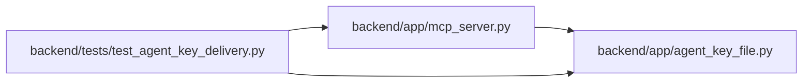

# agent_key_file Module

**Path:** `backend/app/agent_key_file.py`

## Description

Read one agent API key from an owner-only file.

A desktop or sandboxed agent often does not inherit the shell environment the
operator exported a key in. A key file at a known path lets the operator hand
the agent its credential without pasting it into chat or a command line.

## Imports

| Source | Symbols |
|--------|---------|
| `__future__` | `annotations` |
| `os` | `os` |
| `pathlib` | `Path` |
| `stat` | `stat` |

## Local dependency map

<!-- Auto-generated local dependency summary. Do not edit by hand. -->

### Internal neighbors

| Direction | Module |
|---|---|
| Inbound | [mcp_server](../modules/mcp_server.md) |
| Inbound | [test_agent_key_delivery](../modules/test_agent_key_delivery.md) |

## Classes

| Class | Line | Bases | Description |
|-------|------|-------|-------------|
| [AgentKeyFileError](../entities/AgentKeyFileError.md) | 14 | `ValueError` | Raised when a key file is missing, unsafe, or malformed. |

## Functions

| Function | Signature | Decorators | Description |
|----------|-----------|------------|-------------|
| `read_agent_key_file` | `(path: str \| os.PathLike[str]) -> str` | — | Return the single key stored in ``path``. |
