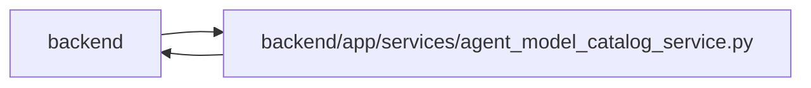

# agent_model_catalog_service Module

**Path:** `backend/app/services/agent_model_catalog_service.py`

## Description

Operator-owned model catalog, binding administration, and audit receipts.

## Imports

| Source | Symbols |
|--------|---------|
| `__future__` | `annotations` |
| `app.commands` | `commit_or_flush` |
| `app.models.agent` | `AgentActor`, `AgentIdempotencyRecord`, `AgentModelBinding`, `AgentModelCatalogEntry`, `AgentRun`, `AgentTaskAssignment`, `TaskEvent` |
| `app.query_limits` | `CollectionLimitExceededError`, `MAX_BOUNDED_LIST_ITEMS` |
| `app.schemas.agent_planning` | `AgentPlanningCommandContext` |
| `app.schemas.agent_routing` | `AgentModelBindingCreate`, `AgentModelBindingDisable`, `AgentModelBindingResponse`, `AgentModelBindingUpdate`, `AgentModelCatalogCreate`, `AgentModelCatalogDisable`, `AgentModelCatalogResponse`, `AgentModelCatalogUpdate`, `AgentModelMutationReceipt` |
| `app.services.agent_service` | `AgentConflictError`, `AgentPermissionError`, `actor_has_scope`, `is_admin_key_principal`, `require_scope`, `validate_idempotency_key` |
| `app.services.routing_qualification_key_service` | `require_known_qualification_keys` |
| `collections.abc` | `Awaitable`, `Callable` |
| `dataclasses` | `dataclass` |
| `hashlib` | `hashlib` |
| `json` | `json` |
| `secrets` | `secrets` |
| `sqlalchemy` | `func`, `select`, `text` |
| `sqlalchemy.exc` | `IntegrityError` |
| `sqlalchemy.ext.asyncio` | `AsyncSession` |
| `sqlalchemy.orm` | `selectinload` |
| `typing` | `Any`, `Literal` |

## Local dependency map

<!-- Auto-generated local dependency summary. Do not edit by hand. -->

> Module-level dependencies exceed the generated-diagram limits, so the diagram and table below group them by top-level package. Counts report the number of module neighbors in each package.

### Internal neighbors

| Direction | Module |
|---|---|
| Inbound | `backend` (13) |
| Outbound | `backend` (7) |

### External packages

| Language | Used packages | Undeclared packages |
|---|---:|---:|
| python | 1 | 0 |

> All 19 module neighbor(s) are summarized by package because the module-level view exceeds the 12-node limit.

## Classes

| Class | Line | Bases | Description |
|-------|------|-------|-------------|
| [AgentModelConflictError](../entities/AgentModelConflictError.md) | 58 | `AgentConflictError` | Stable model-control conflict shared by REST and MCP. |
| [_MutationResult](../entities/MutationResult.md) | 76 | — | — |
| [AgentModelCatalogService](../entities/AgentModelCatalogService.md) | 90 | — | Expose secret-free reads and replay-safe admin model mutations. |
