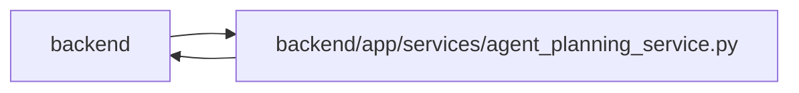

# agent_planning_service Module

**Path:** `backend/app/services/agent_planning_service.py`

## Description

Schedule apply keeps its existing observed task-version set and input-digest proof. Under strict mode, the scheduler receives the revision of the already-locked, digest-validated aggregate. Post-apply digest comparison normalizes only the version increment recorded by the same command, retaining checks on every other mutable input. Idempotent replay uses an actor ID captured before rollback, avoiding implicit loads from expired ORM state.

Safe PM setup commands for authenticated agent actors.

The adapter delegates validation and mutation behavior to the existing domain
services, then stores an exact actor-attributed receipt in the same transaction.

Composed planning mutations share one transaction and retain exact durable mutation receipts. Schedule preview has an explicit rollback owner and a transient receipt with original input versions; apply validates the observed task set and input digest. A preview cannot publish snapshots, idempotency records or outbound work.

The PM preview digest includes the relevant iteration and personal annual calendar rules. Apply checks this digest and the full task-version map before updating the planned dates. SQLite uses a scoped iteration update for its write reservation. On PostgreSQL the service takes shared locks on the selected annual records in ID order.

Preview and apply use the observed iteration revision in the forecast digest. A command that already owns a revision reservation uses its recorded pre-command revision consistently, including after the scheduler writes its outputs. A previously held forecast must be refreshed after another reservation.

## Imports

| Source | Symbols |
|--------|---------|
| `app.commands` | `commit_or_flush`, `atomic_command`, `current_command`, `lock_planning`, `preview_command`, `PlanningConflict` |
| `app.models.agent` | `AgentActor`, `AgentIdempotencyRecord` |
| `app.models.calendar` | `Calendar` |
| `app.models.iteration` | `Iteration` |
| `app.models.task` | `Task`, `TaskDependency` |
| `app.models.team_member` | `TeamMember`, `Vacation` |
| `app.schemas.agent` | `AgentTaskCreate`, `AgentTaskPatch` |
| `app.schemas.agent_planning` | `AgentPlanningCommandContext`, `AgentPlanningReceipt`, `AgentScheduleCommand`, `AgentScheduleResult`, `AgentScheduleTaskState` |
| `app.schemas.iteration` | `IterationCreate`, `IterationUpdate` |
| `app.schemas.project` | `ProjectCreate`, `ProjectMilestoneCreateRequest`, `ProjectMilestoneResponse`, `ProjectMilestoneUpdate`, `ProjectResponse`, `ProjectUpdate` |
| `app.schemas.task` | `TaskCreate`, `TaskResponse`, `TaskUpdate` |
| `app.schemas.task_replacement` | `TaskReplacementResponse` |
| `app.schemas.team` | `CapacityAdjustmentCommand`, `CapacityAdjustmentResult`, `CapacityTransferCommand`, `CapacityTransferResult`, `CapacityTransferWithdrawal`, `TeamMemberCreate`, `TeamMemberProfileCreate`, `TeamMemberProfileResponse`, `TeamMemberProfileUpdate`, `TeamMemberResponse`, `TeamMemberUpdate`, `VacationCreate`, `VacationResponse`, `VacationUpdate` |
| `app.services.agent_profile_catalog_service` | `AgentProfileCatalogService` |
| `app.services.agent_service` | `AgentConflictError`, `require_scope`, `validate_idempotency_key` |
| `app.services.calendar_rules` | `AnnualCalendars` |
| `app.services.capacity_adjustments` | `CapacityAdjustmentService`, `load_dated_availability` |
| `app.services.capacity_service` | `CapacityService` |
| `app.services.capacity_transfers` | `CapacityTransferService`, `CapacityTransferService` |
| `app.services.iteration_service` | `IterationService` |
| `app.services.project_service` | `ProjectService` |
| `app.services.scheduler_service` | `SchedulerService` |
| `app.services.task_replacement_service` | `TaskReplacementService` |
| `app.services.task_service` | `TaskService` |
| `app.services.team_service` | `TeamService` |
| `collections.abc` | `Awaitable`, `Callable`, `Mapping` |
| `hashlib` | `hashlib` |
| `json` | `json` |
| `secrets` | `secrets` |
| `sqlalchemy` | `select`, `update` |
| `sqlalchemy.exc` | `IntegrityError` |
| `sqlalchemy.ext.asyncio` | `AsyncSession` |
| `typing` | `Any` |

## Local dependency map

<!-- Auto-generated local dependency summary. Do not edit by hand. -->

> Module-level dependencies exceed the generated-diagram limits, so the diagram and table below group them by top-level package. Counts report the number of module neighbors in each package.

### Internal neighbors

| Direction | Module |
|---|---|
| Inbound | `backend` (10) |
| Outbound | `backend` (25) |

### External packages

| Language | Used packages | Undeclared packages |
|---|---:|---:|
| python | 1 | 0 |

> All 35 module neighbor(s) are summarized by package because the module-level view exceeds the 12-node limit.

## Classes

| Class | Line | Bases | Description |
|-------|------|-------|-------------|
| [_SchedulePreviewComplete](../entities/SchedulePreviewComplete.md) | 75 | `Exception` | Internal signal used to roll back a schedule preview savepoint. |
| [AgentPlanningService](../entities/AgentPlanningService.md) | 83 | — | Expose bounded PM setup commands without bypassing domain services. |