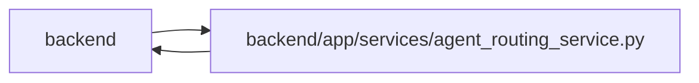

# agent_routing_service Module

**Path:** `backend/app/services/agent_routing_service.py`

## Description

Authoritative assessment, preview, and selection validation for agent routing.

A verification preview on a project that requires different publishers checks the reviewer against the actual execution contributors. The selected actor’s current profile and enabled model binding support the comparison. Missing or conflicting historical attribution is surfaced before the assignment can be accepted.

After supervised rework, the latest successful run and its immutable submission identify the required reviewer profile. Verification preview excludes other profiles, including profiles using the same independent publisher. Dispatch and verdict require the same profile and recheck independence from every contributing publisher.

Routing within the primary year uses iteration working days and that member's iteration vacations. Across years, each working date contributes its actual hours divided by that year's nominal hours. The relevant absences and annual rules contribute to the result. A digest records the annual basis, and missing coverage leaves the workload ratio unknown.

On PostgreSQL, an authenticated dispatch reserves the shared planning revision before taking broad routing table locks. A calendar editor reserves the same revision first. A later dispatch sees the committed annual policy, while a later policy replacement must respect an already issued assignment.

A verification preview checks candidate-bound operator evidence before evaluating fresh dispatch capacity. The PM can request an existing review owner's receipt even while that reviewer is occupied. Source-only substitution depends on the current assessment's explicit review policy.

## Imports

| Source | Symbols |
|--------|---------|
| `__future__` | `annotations` |
| `app.authority` | `require_project` |
| `app.commands` | `commit_or_flush`, `current_command`, `lock_planning` |
| `app.config` | `get_settings` |
| `app.models.agent` | `AgentActor`, `AgentIdempotencyRecord`, `AgentModelBinding`, `AgentRun`, `AgentTaskAssignment`, `TaskRoutingAssessment` |
| `app.models.iteration` | `Iteration` |
| `app.models.task` | `Task`, `TaskStatus` |
| `app.models.team_member` | `TeamMember`, `TeamMemberProfile` |
| `app.query_limits` | `CollectionLimitExceededError` |
| `app.schemas.agent_planning` | `AgentPlanningCommandContext` |
| `app.schemas.agent_routing` | `AgentRoutingCandidate`, `AgentRoutingExclusion`, `AgentRoutingPreviewCreate`, `AgentRoutingPreviewResponse`, `RoutingDecisionSnapshot`, `TaskRoutingAssessmentCommand`, `TaskRoutingAssessmentCreate`, `TaskRoutingAssessmentListResponse`, `TaskRoutingAssessmentMutationReceipt`, `TaskRoutingAssessmentResponse`, `TaskRoutingAssessmentState` |
| `app.services.agent_routing_observability` | `RoutingOperationalEvent`, `record_routing_operational_event`, `routing_exclusion_projection` |
| `app.services.agent_routing_policy` | `MAX_ROUTING_CANDIDATES`, `MAX_ROUTING_EXCLUSIONS`, `MAX_ROUTING_PACKET_BYTES`, `MIN_ROUTING_ASSESSMENT_CONFIDENCE`, `MODEL_FAILURE_CATEGORIES`, `REVIEW_MODE_ORDER`, `ROUTING_DECISION_LINEAGE_FIELDS`, `ROUTING_LINEAGE_AUTHORITY`, `ROUTING_POLICY_VERSION`, `ROUTING_PREVIEW_TTL_SECONDS`, `RoutingBlockerCode`, `RoutingProfileEvidence`, `canonical_routing_json_bytes`, `evaluate_actor_authorization`, `evaluate_assignment_compatibility`, `evaluate_model_envelope`, `evaluate_required_skills`, `normalize_model_failure_category`, `routing_candidate_rank_key`, `review_mode_meets`, `validate_routing_packet_size` |
| `app.services.agent_routing_rollout` | `AgentRoutingRolloutError`, `AgentRoutingRolloutMode`, `AgentRoutingRolloutService`, `AgentRoutingTopologyReadinessStatus` |
| `app.services.agent_service` | `AgentConflictError`, `AgentPermissionError`, `actor_has_scope`, `actor_scopes`, `validate_idempotency_key` |
| `app.services.agent_team_setup_service` | `AgentTeamSetupService`, `AgentTeamSetupService` |
| `app.services.calendar_rules` | `AnnualCalendars` |
| `app.services.capacity_service` | `CapacityService` |
| `app.services.review_evidence` | `assignment_observation`, `requirements_for`, `resolve` |
| `app.services.review_provenance` | `different_publisher_required`, `historical_profile`, `review_history` |
| `app.services.task_brief_service` | `brief_definition_blockers` |
| `app.services.task_service` | `TaskService`, `TaskVersionConflictError` |
| `app.utils.time` | `as_utc`, `utc_now` |
| `dataclasses` | `dataclass` |
| `datetime` | `UTC`, `datetime`, `timedelta` |
| `hashlib` | `hashlib` |
| `hmac` | `hmac` |
| `json` | `json` |
| `math` | `math` |
| `secrets` | `secrets` |
| `sqlalchemy` | `func`, `select`, `text`, `update` |
| `sqlalchemy.exc` | `IntegrityError` |
| `sqlalchemy.ext.asyncio` | `AsyncSession` |
| `sqlalchemy.orm` | `selectinload` |
| `typing` | `Any`, `Sequence` |

## Local dependency map

<!-- Auto-generated local dependency summary. Do not edit by hand. -->

> Module-level dependencies exceed the generated-diagram limits, so the diagram and table below group them by top-level package. Counts report the number of module neighbors in each package.

### Internal neighbors

| Direction | Module |
|---|---|
| Inbound | `backend` (18) |
| Outbound | `backend` (22) |

### External packages

| Language | Used packages | Undeclared packages |
|---|---:|---:|
| python | 1 | 0 |

> All 38 module neighbor(s) are summarized by package because the module-level view exceeds the 12-node limit.

## Classes

| Class | Line | Bases | Description |
|-------|------|-------|-------------|
| [AgentRoutingConflictError](../entities/AgentRoutingConflictError.md) | 116 | `AgentConflictError` | Stable routing conflict shared by REST, MCP, and assignment commands. |
| [RoutingSelectionValidation](../entities/RoutingSelectionValidation.md) | 136 | — | Authoritative result consumed inside the assignment transaction. |
| [AgentRoutingService](../entities/AgentRoutingService.md) | 203 | — | Create immutable assessments and deterministic exact-actor previews. |

## Functions

| Function | Signature | Decorators | Description |
|----------|-----------|------------|-------------|
| `_request_hash` | `(payload: dict[str, Any]) -> str` | — | — |
| `_json_value` | `(value: Any, fallback: Any) -> Any` | — | — |
| `_brief_sections` | `(description: str \| None) -> dict[str, str]` | — | — |
| `_assessment_payload` | `(record: TaskRoutingAssessment) -> dict[str, Any]` | — | — |
| `_json_projection` | `(value: Any) -> Any` | — | Convert nested schema/time values to the canonical JSON-native boundary. |
