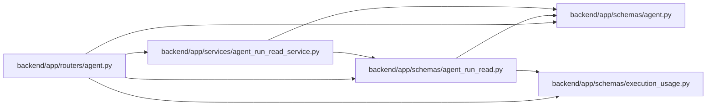

# agent_run_read Module

**Path:** `backend/app/schemas/agent_run_read.py`

## Description

A run as a reader sees it: status, model, harness session and declared usage, without logs.

## Imports

| Source | Symbols |
|--------|---------|
| `app.schemas.agent` | `AgentAssignmentActorSummary` |
| `app.schemas.execution_usage` | `ExecutionUsageResponse` |
| `datetime` | `datetime` |
| `pydantic` | `BaseModel` |
| `typing` | `Optional` |

## Local dependency map

<!-- Auto-generated local dependency summary. Do not edit by hand. -->

### Internal neighbors

| Direction | Module |
|---|---|
| Inbound | [routers_agent](../modules/routers_agent.md) |
| Inbound | [agent_run_read_service](../modules/agent_run_read_service.md) |
| Outbound | [schemas_agent](../modules/schemas_agent.md) |
| Outbound | [schemas_execution_usage](../modules/schemas_execution_usage.md) |

### External packages

| Language | Used packages | Undeclared packages |
|---|---:|---:|
| python | 1 | 0 |

## Classes

| Class | Line | Bases | Description |
|-------|------|-------|-------------|
| [AgentRunHarness](../entities/AgentRunHarness.md) | 12 | `BaseModel` | The harness session the actor declared at begin; never verified. |
| [AgentRunReadItem](../entities/AgentRunReadItem.md) | 19 | `BaseModel` | One run, for people, observers, operators and planning agents. |
