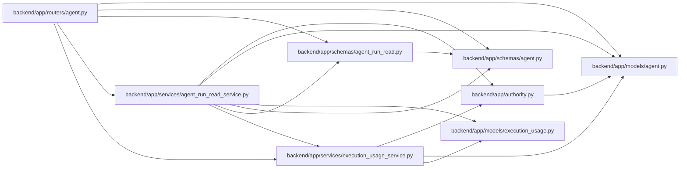

# agent_run_read_service Module

**Path:** `backend/app/services/agent_run_read_service.py`

## Description

List runs for readers within the task read scope.

## Imports

| Source | Symbols |
|--------|---------|
| `app.authority` | `internal_authority` |
| `app.models.agent` | `AgentActor`, `AgentRun` |
| `app.models.execution_usage` | `ExecutionUsageRecord` |
| `app.schemas.agent` | `AgentAssignmentActorSummary` |
| `app.schemas.agent_run_read` | `AgentRunHarness`, `AgentRunReadItem` |
| `app.services.execution_usage_service` | `ExecutionUsageService`, `run_identity` |
| `sqlalchemy` | `select` |

## Local dependency map

<!-- Auto-generated local dependency summary. Do not edit by hand. -->

### Internal neighbors

| Direction | Module |
|---|---|
| Inbound | [routers_agent](../modules/routers_agent.md) |
| Outbound | [authority](../modules/authority.md) |
| Outbound | [models_agent](../modules/models_agent.md) |
| Outbound | [models_execution_usage](../modules/models_execution_usage.md) |
| Outbound | [schemas_agent](../modules/schemas_agent.md) |
| Outbound | [agent_run_read](../modules/agent_run_read.md) |
| Outbound | [execution_usage_service](../modules/execution_usage_service.md) |

### External packages

| Language | Used packages | Undeclared packages |
|---|---:|---:|
| python | 1 | 0 |

## Classes

| Class | Line | Bases | Description |
|-------|------|-------|-------------|
| [AgentRunReadService](../entities/AgentRunReadService.md) | 13 | — | — |
