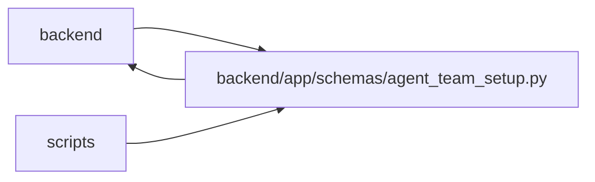

# agent_team_setup Module

**Path:** `backend/app/schemas/agent_team_setup.py`

## Description

Portable agent-team setup, reconciliation, and readiness contracts.

Each role must declare its own immutable role package: the controller `workchord-pm`, workers `workchord-worker`, and verifiers `workchord-reviewer`. Validation rejects any other pairing, so a verifier still declaring the PM package fails before planning.

Those role rules apply to contracts coming in. `load_stored_agent_team_member` and `load_stored_agent_team_master` read what an earlier apply stored with every shape check but tolerate a member that breaks today's role rules: it is marked while read, stays readable wherever it is embedded, and `role_rule_violation()` names the broken rule. A dict round trip drops the mark, so plain data is again checked against today's rules.

## Imports

| Source | Symbols |
|--------|---------|
| `__future__` | `annotations` |
| `app.autonomy.canonical` | `StrictContractModel`, `canonical_json_bytes`, `ensure_secret_free`, `sha256_hex` |
| `datetime` | `datetime` |
| `enum` | `StrEnum` |
| `pydantic` | `ConfigDict`, `Field`, `PrivateAttr`, `ValidationInfo`, `field_validator`, `model_validator` |
| `re` | `re` |
| `typing` | `Any`, `Literal`, `Mapping` |
| `urllib.parse` | `parse_qsl`, `urlsplit` |

## Local dependency map

<!-- Auto-generated local dependency summary. Do not edit by hand. -->

> Module-level dependencies exceed the generated-diagram limits, so the diagram and table below group them by top-level package. Counts report the number of module neighbors in each package.

### Internal neighbors

| Direction | Module |
|---|---|
| Inbound | `backend` (12) |
| Inbound | `scripts` (3) |
| Outbound | `backend` (1) |

### External packages

| Language | Used packages | Undeclared packages |
|---|---:|---:|
| python | 1 | 0 |

> All 16 module neighbor(s) are summarized by package because the module-level view exceeds the 12-node limit.

## Classes

| Class | Kind | Line | Bases / Target | Description |
|-------|------|------|----------------|-------------|
| [UnsupportedAgentTeamMasterVersion](../entities/UnsupportedAgentTeamMasterVersion.md) | Class | 116 | `ValueError` | Raised when a caller submits an unknown manifest schema version. |
| [AgentTeamReconciliationClass](../entities/agent_team_setup_AgentTeamReconciliationClass.md) | Enum | 120 | `StrEnum` | — |
| [AgentTeamMemberLifecycle](../entities/AgentTeamMemberLifecycle.md) | Enum | 130 | `StrEnum` | — |
| [AgentTeamActionStatus](../entities/AgentTeamActionStatus.md) | Enum | 140 | `StrEnum` | — |
| [AgentTeamSetupModel](../entities/AgentTeamSetupModel.md) | Pydantic model | 171 | `StrictContractModel` | Strict base with JSON-schema metadata shared by setup contracts. |
| [AgentTeamSkillPackage](../entities/agent_team_setup_AgentTeamSkillPackage.md) | Pydantic model | 184 | `AgentTeamSetupModel` | Exact immutable role-package identity expected by one runtime. |
| [AgentTeamMemberSpec](../entities/agent_team_setup_AgentTeamMemberSpec.md) | Pydantic model | 192 | `AgentTeamSetupModel` | Portable desired state for one logical actor/runtime membership. |
| [AgentTeamReadinessPolicy](../entities/AgentTeamReadinessPolicy.md) | Pydantic model | 279 | `AgentTeamSetupModel` | Backend-owned minimum topology needed before runtime readiness. |
| [AgentTeamMaster](../entities/agent_team_setup_AgentTeamMaster.md) | Pydantic model | 291 | `AgentTeamSetupModel` | Canonical portable desired-state document for one agent team. |
| [AgentTeamCurrentMember](../entities/AgentTeamCurrentMember.md) | Pydantic model | 469 | `AgentTeamSetupModel` | Redacted authoritative member projection used by reconciliation. |
| [AgentTeamCurrentSnapshot](../entities/AgentTeamCurrentSnapshot.md) | Pydantic model | 481 | `AgentTeamSetupModel` | Current topology state with installation-local IDs kept separate. |
| [AgentTeamPlanAction](../entities/agent_team_setup_AgentTeamPlanAction.md) | Pydantic model | 493 | `AgentTeamSetupModel` | One stable, redacted reconciliation decision. |
| [AgentTeamReconciliationPlan](../entities/agent_team_setup_AgentTeamReconciliationPlan.md) | Pydantic model | 530 | `AgentTeamSetupModel` | Digest-bound dry-run output applied only by exact action ID. |
| [AgentTeamManifestRequest](../entities/AgentTeamManifestRequest.md) | Pydantic model | 762 | `AgentTeamSetupModel` | — |
| [AgentTeamValidateResponse](../entities/AgentTeamValidateResponse.md) | Pydantic model | 766 | `AgentTeamSetupModel` | — |
| [AgentTeamPlanRequest](../entities/AgentTeamPlanRequest.md) | Pydantic model | 777 | `AgentTeamSetupModel` | — |
| [AgentTeamApplyRequest](../entities/AgentTeamApplyRequest.md) | Pydantic model | 782 | `AgentTeamSetupModel` | — |
| [AgentTeamActionReceipt](../entities/agent_team_setup_AgentTeamActionReceipt.md) | Pydantic model | 811 | `AgentTeamSetupModel` | — |
| [AgentTeamApplyResponse](../entities/agent_team_setup_AgentTeamApplyResponse.md) | Pydantic model | 825 | `AgentTeamSetupModel` | — |
| [AgentTeamRuntimeAcknowledgement](../entities/AgentTeamRuntimeAcknowledgement.md) | Pydantic model | 850 | `AgentTeamSetupModel` | — |
| [AgentTeamRuntimeAcknowledgementResponse](../entities/AgentTeamRuntimeAcknowledgementResponse.md) | Pydantic model | 896 | `AgentTeamSetupModel` | — |
| [AgentTeamRuntimeHandoff](../entities/agent_team_setup_AgentTeamRuntimeHandoff.md) | Pydantic model | 913 | `AgentTeamSetupModel` | — |
| [AgentTeamMemberStatus](../entities/agent_team_setup_AgentTeamMemberStatus.md) | Pydantic model | 941 | `AgentTeamSetupModel` | — |
| [AgentTeamSetupStep](../entities/agent_team_setup_AgentTeamSetupStep.md) | Pydantic model | 979 | `AgentTeamSetupModel` | — |
| [AgentTeamStatusResponse](../entities/AgentTeamStatusResponse.md) | Pydantic model | 994 | `AgentTeamSetupModel` | — |
| [AgentTeamSetupReportCounts](../entities/AgentTeamSetupReportCounts.md) | Pydantic model | 1028 | `AgentTeamSetupModel` | Bounded lifecycle and current-work counts without member internals. |
| [AgentTeamSetupReportEvidence](../entities/AgentTeamSetupReportEvidence.md) | Pydantic model | 1065 | `AgentTeamSetupModel` | Durable reconciliation evidence summarized without action payloads. |
| [AgentTeamTopologyMemberRead](../entities/AgentTeamTopologyMemberRead.md) | Pydantic model | 1083 | `AgentTeamSetupModel` | Which actor a team member is and which runtime reference runs it. |
| [AgentTeamTopologyResponse](../entities/AgentTeamTopologyResponse.md) | Pydantic model | 1104 | `AgentTeamSetupModel` | The team as a reader sees it: members, roles, model bindings and runtime references. |
| [AgentTeamDispatchAvailability](../entities/AgentTeamDispatchAvailability.md) | Pydantic model | 1127 | `AgentTeamSetupModel` | Explicitly withhold availability claims without task-bound evidence. |
| [AgentTeamSetupReport](../entities/AgentTeamSetupReport.md) | Pydantic model | 1157 | `AgentTeamSetupModel` | Portable redacted topology report derived only from current server state. |

## Functions

| Function | Signature | Decorators | Description |
|----------|-----------|------------|-------------|
| `_normalize_unique_keys` | `(values: tuple[str, ...], *, label: str) -> tuple[str, ...]` | — | — |
| `_validate_reference` | `(value: str, *, label: str) -> str` | — | — |
| `ensure_agent_team_secret_free` | `(value: Any) -> None` | — | Enforce setup-specific secret, prompt, environment, and log exclusions. |
| `parse_agent_team_master` | `(value: Any) -> AgentTeamMaster` | — | Validate one supported manifest and return its canonical model. |
| `load_stored_agent_team_member` | `(payload: str) -> AgentTeamMemberSpec` | — | Read a member contract an earlier apply stored. |
| `load_stored_agent_team_master` | `(payload: str) -> AgentTeamMaster` | — | Read a stored manifest the way ``load_stored_agent_team_member`` does. |
| `_member_projection` | `(member: AgentTeamMemberSpec) -> dict[str, Any]` | — | — |
| `_build_action` | `(*, desired: AgentTeamMaster, actor_key: str, classification: AgentTeamReconciliationClass, operation: str, target_actor_id: int \| None, expected_object_revision: int \| None, expected_actor_revision: int \| None, before: dict[str, Any] \| None, after: dict[str, Any] \| None, blocker_code: str \| None = None, requires_confirmation: bool = False, authority_change: bool = False) -> AgentTeamPlanAction` | — | — |
| `reconcile_agent_team_master` | `(desired: AgentTeamMaster, current: AgentTeamCurrentSnapshot) -> AgentTeamReconciliationPlan` | — | Derive a deterministic, non-destructive baseline reconciliation plan. |
